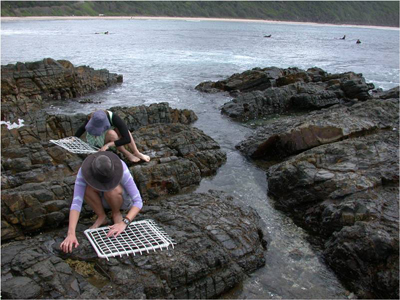

Throughout this site, instructions for statistical analyses, data management and graphical techniques are provided in the software language R. R is a free, open source language that has rapidly become standard usage in the biological and environmental sciences. Apart from the cost, the language has the benefits of being able to explicitly share methods with colleague, and a very active community of people who are developing packages that will run very many types of analyses and graphics.

Before you get started with making graphics and doing analyses, you will need to:

* [Install R and learn the basics of using R](r.qmd)  
* Think about [project management](projects.qmd) to plan how you are going to organise your files 
* Keep your code, results and notes together in an [R notebook](rstudio-notebooks.qmd)

## Data entry

{fig-alt="Two people crouching on a rocky shore, placing square sampling quadrats over rock pools"}

After collecting data, being able to enter those data and import into various software packages are obviously essential skills for students and researchers in the environmental sciences. You might think that you just write the numbers in a spreadsheet package and open that file in another piece of software, but there is actually quite a bit to be learnt about tidy ways to enter the data and import that data without errors.

On these pages, we give some guidance for data entry that will save a lot of time when it comes to analysing data and making effective figures. We also describe the types and structure of data objects in R that you will see once you have imported your data. 

* [Data entry](../data-literacy/data-entry.qmd) - organising data when first entering it into a spreadsheet.  
* [Importing data](../data-literacy/reading/index.qmd) into R  
* [Data types and structure](../data-literacy/data-types-structure.qmd) - better understanding data objects in R  

{fig-alt="A spreadsheet of plant data with one row per observation and columns such as species, family, growth form, height, country, latitude, longitude and temperature"}

## Further help

The British Ecological Society's [Guide to Data Management in Ecology and Evolution](http://www.britishecologicalsociety.org/wp-content/uploads/Publ_Data-Management-Booklet.pdf)

**Author**: Alistair Poore

**Year:** 2016
