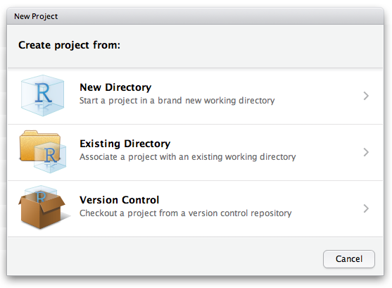
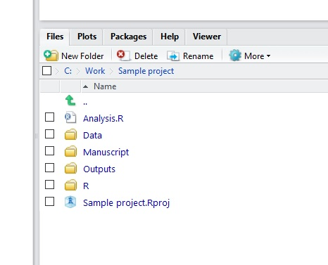

Having your data files, R scripts and outputs organised is very helpful for keeping track of what you are working on and for sharing data or scripts with colleagues or supervisors. Try and avoid a folder on your computer that is a big mix of spreadsheets, images, word processing documents etc. How you organise your files is your choice, but a little bit of planning and project organization at the beginning will pay lots of dividends down the road.  Here are our suggestions for keeping your projects neatly organised.

## Setting up an organised project folder

Create a folder on your computer for each project. This could be a course you are currently doing, a chapter of your thesis or a research project of any kind. Within that folder, include the following things:

* A data folder (including meta-data)
* An outputs folder (with subfolders "Figures" and "Tables" and possibly "Supplementary Material")
* An R script that will run the data manipulation, analyses and create figures required for the project (try to keep this R script short and readable)
* A folder for R functions (if used) usually called "R"
* A folder for writing and references called "Manuscripts"

The data folder should hold the raw data (usually entered in a spreadsheet program).   After you finish entering your data, you should aim to keep these data untouched; all the things you want to do with the data, such as data cleaning and [subsetting](../data-literacy/filter-rows/index.qmd), [summarising](../data-literacy/summarising-tables/index.qmd) data into table, running statistical [analyses](../statistical-methods/linear-models.qmd) or creating [figures](../data-visualisation/data-visualisation.qmd), can be done via R scripts.  This keeps a record of everything you do.  Think of this script(s) as the lab notebook for a data scientist. Intermediate outputs are good--separate these from the raw data and save them in the outputs folder.

One goal of this project organization is that your data processing and analysis is entirely reproducible, and as such both the data and exact methods can be shared with colleagues and supervisors, who can then repeat and hopefully build on your analyses. Also, although you might know all the files and steps at the moment, think of yourself in a year once you've moved on to other jobs or projects; try to be nice to your future self and keep good notes. In contrast, if you used a point--and--click or spreadsheet program to do important steps in your analysis, you'll need to remember all the steps taken to recreate the analyses or figures.  Most analyses at some point get too complicated for this to be tractable.

## Using RStudio project (.Rproj) files

RStudio can turn your project folder into an RStudio project. This adds a small file ending in `.Rproj` to the folder (for example `Sample project.Rproj`). Opening that file opens RStudio with everything set up for that project:

* the working directory is set to the project folder, so you never need `setwd()`
* the Files pane shows the project folder
* the scripts you had open last time are reopened, and your command history is kept separately for each project
* each project runs in its own R session, so you can have two projects open in two RStudio windows without their objects getting mixed up

### Creating a project

In RStudio, click **File, New Project...**. You will be asked whether to create the project in a new directory, in an existing directory, or from version control (for example, a copy of a GitHub repository).

{fig-alt="RStudio's New Project dialog, offering to create a project from a New Directory, an Existing Directory or Version Control"}

Choose **Existing Directory** to add a project file to the folder you created above, or **New Directory** to create the folder and the project file together. You can also tick **Create a git repository** if you plan to use [version control](../coding-skills/version-control.qmd).

RStudio creates the `.Rproj` file and a hidden `.Rproj.user` folder, where it keeps its own settings for the project, such as which files were open. You don't need to edit either of these.

### Opening a project

Open your project by double-clicking the `.Rproj` file, or from **File, Open Project...** if RStudio is already open. The name of the open project is shown at the top right of RStudio. Clicking it gives a menu of your recent projects, which is the easiest way to switch between them.

Once open, you will see your directory structure in the Files pane on the bottom right of RStudio and all your scripts and data are easily accessible.

{fig-alt="RStudio's Files panel showing a sample project folder containing Analysis.R, Data, Manuscript, Outputs and R folders, and a Sample project.Rproj file"}

Make a habit of always starting work by opening the project, rather than opening an R script on its own. If you open a script by itself, the working directory will be wherever RStudio last left it, and your file paths will not work.

### Reading and writing files with relative paths

A big benefit of using a project is that file paths can be written relative to the project folder. When using `read.csv("")`, press Tab while your cursor is within the `""` to choose from the folders and files in your project:

```{r}
#| label: projects-1
#| eval: false
survey <- read.csv("Data/Survey_data.csv")
```

Compare this with the alternatives, a full path to the file, or setting the working directory first. Both only work on your own computer, because nobody else has a `C:/Work/Data` folder:

```{r}
#| label: projects-2
#| eval: false
survey <- read.csv("C:/Work/Data/Survey_data.csv")

setwd("C:/Work/Data")
survey <- read.csv(file = "Survey_data.csv")
```

Similarly, when you output a file (e.g., figures or tables), you can store it in your outputs folder, away from the raw data:

```{r}
#| label: projects-3
#| eval: false
write.csv(survey_summary, "Outputs/Tables/Survey_summary_table.csv")
```

You can now simply copy your whole project folder to any other computer (desktop to laptop, student to supervisor etc.) and your code will work without having to change the working directory for every machine.

### Files in subfolders and the here package

There is one catch. When you render a [Quarto document](rstudio-notebooks.qmd), its code runs in the folder that contains the document, not the project folder. So if your document is in a `Manuscripts` folder, `read.csv("Data/Survey_data.csv")` will fail.

The [here](https://here.r-lib.org/) package solves this. `here::here()` builds a path that starts at the project folder (it finds the folder by looking for the `.Rproj` file), wherever your script or document is:

```{r}
#| label: projects-4
#| eval: false
survey <- read.csv(here::here("Data", "Survey_data.csv"))
```

This works the same from the console, a script, or a Quarto document in any subfolder of the project.

### Start each session with a clean slate

By default, RStudio saves all the objects in your environment to a file called `.RData` when you quit, and loads them again next time. This sounds helpful, but it means your analysis can quietly depend on objects that your code no longer creates. We recommend turning it off: go to **Tools, Global Options..., General**, untick **Restore .RData into workspace at startup**, and set **Save workspace to .RData on exit** to **Never**. Your scripts, not your workspace, should be the record of your work, and a fresh session each time checks that they still run.

The same options are available for a single project in **Tools, Project Options...**.

### Projects and version control

If your project is under [version control](../coding-skills/version-control.qmd) with git, commit the `.Rproj` file so collaborators can open the project the same way. Don't commit the `.Rproj.user` folder: it holds your personal settings, and RStudio adds it to the project's `.gitignore` file for you.

### Other editors

`.Rproj` files belong to RStudio. In [Positron](https://positron.posit.co/) or VS Code, the equivalent is to open the project folder itself (**File, Open Folder...**), which also sets the working directory to that folder. The `here` package works in all of them.

## Further help

Posit's guide to [using RStudio projects](https://docs.posit.co/ide/user/ide/guide/code/projects.html)

The [Projects](https://r4ds.hadley.nz/workflow-scripts.html#projects) section of *R for Data Science*

The [here](https://here.r-lib.org/) package

Our introduction to [version control](../coding-skills/version-control.qmd) for keeping track of revisions to project files.

**Author**: Alistair Poore & Will Cornwell

**Year:** 2016 (updated 2026)
