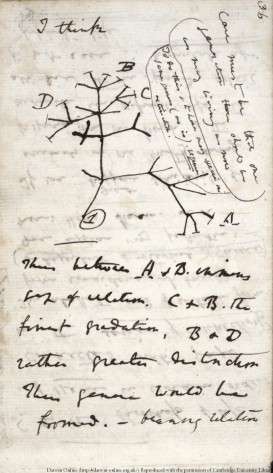
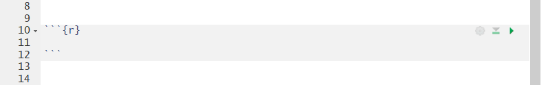
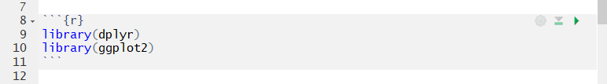
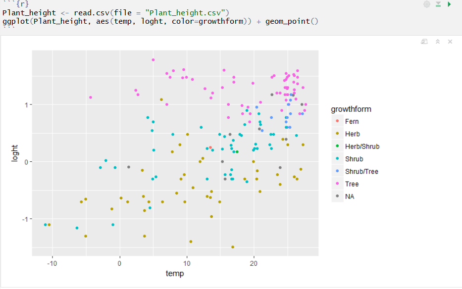
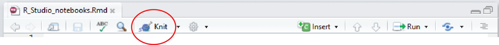

```{r}
#| label: rstudio-notebooks-1
#| echo: false
#| message: false
library(dplyr)
library(ggplot2)
```

If you are working in the laboratory or in the field, it is essential to keep good notes on what you are doing so that you can remember your methods and ensure that your work is reproducible.

{fig-alt="A page from Charles Darwin's notebook with his 'I think' sketch of a branching tree of species"}

Similarly, once you are dealing with the data you have collected, good notes on how you have processed that data are essential. They help you in understanding exactly what you are doing and are needed to write methods sections, and to communicate both methods and results to collaborators or supervisors.

In a traditional R script, all the text is code and comments are separated from executable code by starting a line with #. For example,

```{r}
#| label: rstudio-notebooks-2
#| eval: false
plot(y ~ x)
# code to make a plot of y vs x
```

This can get messy if you have lots of comments. A cleaner way is to write a document that mixes plain text with chunks of code, and shows the output of the code (tables, statistics and figures) right next to it. There are two common formats for this in R:

- **Quarto documents** (`.qmd` files) are the current standard, and RStudio's default for new reports. Every chapter of this book is a Quarto document.
- **R Markdown documents and R notebooks** (`.Rmd` files) are the older format. You will still meet them in other people's projects and in many online tutorials, so they are covered [at the end of this page](#r-notebooks-and-r-markdown).

Both are written in markdown, a simple way of formatting plain text, and both run the same R code. We recommend Quarto for new work.

## Creating a Quarto document

Quarto comes bundled with recent versions of RStudio. To create a new document, click **File, New File, Quarto Document...** from the RStudio menu, give it a title, and click **Create**. Untick **Use visual markdown editor** if you want to see the markdown source rather than a word-processor style view (you can switch at any time with the **Source** and **Visual** buttons).

Quarto also works in [Positron](https://quarto.org/docs/tools/positron/) and VS Code, if you use one of those editors instead of RStudio.

Save the file in a folder on your computer, ideally inside an [RStudio project](projects.qmd). That folder becomes the working directory for the code in your document, so there is no need to set the working directory.

Delete the example text that comes with the new document, but leave the lines at the top between the `---` marks. Your document is now a blank page for writing down all the steps involved in your work. For example, you might want to start with a brief description of the project.

## The YAML header

The lines between the `---` marks at the top of the document are called the YAML header. They set the title and control what the finished document looks like. A good starting point is:

```yaml
---
title: "Effects of temperature on plant height"
author: "Your Name"
format:
  html:
    embed-resources: true
---
```

`embed-resources: true` puts the figures and styling inside the HTML file itself, so you end up with a single file that you can email to a supervisor or collaborator. Without it, the figures are saved in a separate folder that has to travel with the file.

## Adding code to your document

Executable code goes in what are called chunks. To add one, click the green **+C** button at the top of your document and choose **R**, or press **Ctrl + Alt + I** (**Cmd + Option + I** on a Mac). This adds an empty chunk that looks like this:

{fig-alt="An empty R code chunk in an RStudio notebook"}

Any code that you want to run goes inside the chunk. It is a good idea to use the first chunk to load any R packages that the rest of the document needs. For example,

{fig-alt="An R code chunk containing library(dplyr) and library(ggplot2)"}

Be careful not to delete the ```` ``` ```` marks, or the text will no longer be recognised as code.

## Running the code

To run all the code in a chunk, click the little green arrow at the top right of the chunk. Just like in a script, you can still run individual lines of code by pressing **Ctrl + Enter** (**Cmd + Return** on a Mac) with your cursor on that line.

Use the chunks to organise your workflow, grouping code that does a particular task within a chunk and preceding these by plain text that explains what each chunk will do. Avoid putting every single line of code in a separate chunk and avoid having very many lines of code that do different things within the same chunk.

By default, output from your code appears directly below the chunk rather than in the console or the plots pane. For example, a plot of plant height vs temperature from the data set used in our [linear regression tutorial](../statistical-methods/linear-regression.qmd):

{fig-alt="An R chunk that reads Plant_height.csv and plots it with ggplot, with the resulting scatterplot of log height against temperature, coloured by growth form, shown directly below the chunk"}

If you prefer output in the console and plots pane, click the cog symbol next to **Render** and choose **Chunk Output in Console**.

If you have changed any code or data files, you will need to run the code again. The **Run** menu at the top right of the document has **Run All**, and **Run All Chunks Above**, which is very useful when you are part way through a document and want to make sure everything before it is up to date.

## Rendering your document

Clicking **Render** (or pressing **Ctrl + Shift + K**, **Cmd + Shift + K** on a Mac) runs all the code from scratch, in a fresh R session, and turns your document into a finished report. Running everything from scratch is a useful check that your analysis really does work from start to finish, and doesn't rely on something you happened to have in your environment.

By default the report is an HTML file, which opens in the RStudio Viewer or your browser. HTML files are an excellent way to share your work with collaborators and supervisors. The single file can be opened in any browser on any device and has all your text, code, statistical output and figures. Your reader doesn't need to run any code (or even be an R user) to see what you have done.

Two more options in the YAML header make HTML reports even more useful:

```yaml
format:
  html:
    embed-resources: true
    code-fold: true
    code-tools: true
```

`code-fold: true` hides each chunk of code behind a "Code" button, so readers see the results first and can open the code if they want it. `code-tools: true` adds a menu at the top of the page to show or hide all the code, and to view the source of the whole document.

To make a Word document or a PDF instead, change the format to `docx` or `pdf`, or list more than one format and choose between them from the arrow next to **Render**:

```yaml
format:
  html: default
  docx: default
```

Making PDFs needs LaTeX. The simplest way to get it is to run `quarto install tinytex` in RStudio's Terminal tab.

When you first look at your report, you may realise that there are some unwanted parts (e.g., warning messages) and that the formatting could be improved. To fix these, you need to learn a bit more about basic formatting and controlling the behaviour of code chunks.

## Some basic markdown formatting

Text outside the chunks is written in markdown. Here are a few of the most useful bits of formatting:

| You type | You get |
|----|----|
| `# Heading 1` | a top-level heading |
| `## Heading 2` | a second-level heading |
| `### Heading 3` | a third-level heading |
| `*italics*` | *italics* |
| `**bold**` | **bold** |
| `[Environmental Computing](https://environmentalcomputing.net)` | a link: [Environmental Computing](../../index.qmd) |
| `` | an image: {fig-alt="Environmental Computing logo: a seedling with two leaves growing out of a laptop screen" width="60"} |

Quarto's [markdown basics](https://quarto.org/docs/authoring/markdown-basics.html) page covers lists, tables, equations and much more.

## Controlling chunk behaviour

You can control how each chunk's code and output appear in the finished report with chunk options. In a Quarto document, they go at the top of the chunk on lines that start with `#|`. There are lots of these (see Quarto's [execution options](https://quarto.org/docs/computations/execution-options.html)), but a few useful ones are below.

To show the code but not run it:

```{{r}}
#| eval: false
2 + 2
```

To run the code but hide it, showing only the output:

```{{r}}
#| echo: false
2 + 2
```

To hide messages and warnings, for example the start-up messages printed when some packages load:

```{{r}}
#| message: false
#| warning: false
library(dplyr)
```

To change the size of a plot (in inches):

```{r}
#| label: rstudio-notebooks-3
#| echo: false
Plant_height <- read.csv(file = "data/Plant_height.csv")
```

```{{r}}
#| fig-height: 3
#| fig-width: 10
ggplot(Plant_height, aes(temp, loght)) +
  geom_point()
```

```{r}
#| label: rstudio-notebooks-4
#| echo: false
#| fig-alt: "A wide, short scatterplot of log plant height against temperature, showing the effect of setting fig-height to 3 and fig-width to 10"
#| fig-height: 3
#| fig-width: 10
ggplot(Plant_height, aes(temp, loght)) +
  geom_point()
```

Options can also be set once in the YAML header, rather than in every chunk. For example, to hide all warnings and make every figure 6 inches wide:

```yaml
execute:
  warning: false
format:
  html:
    fig-width: 6
```

## R notebooks and R Markdown

R Markdown (`.Rmd`) was the standard format before Quarto, and you will still come across it. Most of this page applies to it too, with a few differences:

- Create one with **File, New File, R Markdown...**, or **File, New File, R Notebook** for an R notebook, which is an R Markdown document that saves your chunk output as you work (in a `.nb.html` file next to the `.Rmd`), so you see your plots again when you reopen it.
- Instead of **Render**, there is **Knit** (or **Preview** in a notebook). **Knit to HTML** makes an HTML report.
- The format in the YAML header is written `output: html_document` rather than `format: html`.
- Chunk options are traditionally written inside the curly brackets at the top of the chunk, rather than on `#|` lines. For example, ```` ```{r, eval=FALSE} ```` is the same as an `#| eval: false` line, and ```` ```{r, fig.height=3, fig.width=10} ```` is the same as `#| fig-height: 3` and `#| fig-width: 10`.

{fig-alt="The RStudio notebook toolbar with the Knit button circled"}

Quarto can render most `.Rmd` files as they are, and turning one into a Quarto document is mostly a matter of renaming it to `.qmd` and changing `output:` to `format:` in the YAML header. Quarto's [FAQ for R Markdown users](https://quarto.org/docs/faq/rmarkdown.html) explains the differences in more detail.

## Further help

Quarto's [tutorial for RStudio](https://quarto.org/docs/get-started/hello/rstudio.html)

Quarto's guide to [using R](https://quarto.org/docs/computations/r.html) and to [HTML code options](https://quarto.org/docs/output-formats/html-code.html) such as code folding

The R Markdown Definitive Guide's [chapter on notebooks](https://bookdown.org/yihui/rmarkdown/notebook.html)

**Author**: Alistair Poore

**Year:** 2016 (updated 2026)
