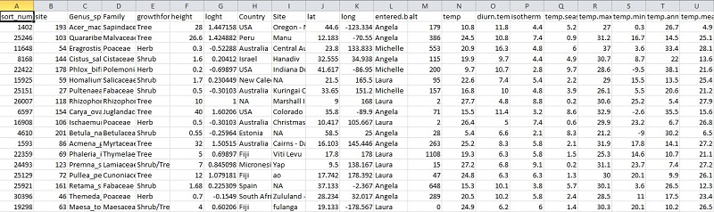

Having skills in organising and summarising data is crucial for students and researchers in all sciences. On these pages, we give some guidance for manipulating data in ways that can save a lot of time when it comes to analysing data and making effective figures. 

Data manipulation using the packages [dplyr](https://cran.r-project.org/web/packages/dplyr/index.html), [tidyr](https://blog.rstudio.org/2014/07/22/introducing-tidyr/) and [reshape2](https://cran.r-project.org/web/packages/reshape2/).

* [Making new variables](mutate/index.qmd)
* [Subsetting data](filter-rows/index.qmd) - selecting rows and columns  
* [Summarising data](summarising-tables/index.qmd) - extracting summary statistics  
* [Combining data sets](joining-tables/index.qmd) - joining entire data sets, or parts by matching rows
* [Reshaping data](pivotting/index.qmd) between wide and long formats  

## Further help

The British Ecological Society's [Guide to Data Management in Ecology and Evolution](http://www.britishecologicalsociety.org/wp-content/uploads/Publ_Data-Management-Booklet.pdf)

**Author**: Alistair Poore

**Year:** 2016
