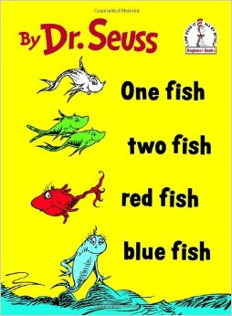

Learning how to format data is an essential skill to allow you to easily produce figures and run analyses. You should always aim for data that are formatted with each observation as a row and each variable as a column (see help on [Data entry](../../misc/data-entry.qmd)). For some types of variables, however, there are choices to be made about how you input the data.

For example, it is very common in the biological sciences that we record the abundance of many species of organisms from each of our replicate observations (transects, quadrats, surveys etc). We then have two choices for how to input that data:

1. a separate column for every species that records its abundance, or,
2. two columns - one that identifies the species and one that records the abundance.

{fig-alt="Cover of Dr. Seuss's book One Fish Two Fish Red Fish Blue Fish"}

Consider a data set that recorded the abundance of fish from each of three transects that were set up on two reefs in two separate months. First, import this sample data set, [ReefFish.csv](../../../datasets/ReefFish.csv), to see the way it is formatted.

```{r}
#| label: index-1
ReefFish <- read.csv(file = "ReefFish.csv", header = T)
```

```{r}
#| label: index-2
#| echo: false
head(ReefFish)
```

This data frame is arranged in a **long format** with one variable that identifies the fish species, and one variable that holds the abundance data. The other three variables identify each transect (Site, Month and Transect),

This format is efficient for data entry as you only need to have rows for the species that were present in that particular transect, and don't have to keep adding columns every time a new species is recorded. You would need the data in this format if you wanted to use a plot to contrast the abundance of fish among the three species.

If, however, you would like to contrast the abundance of one of the species, or create a species by sample matrix that is required by the various multivariate analyses that contrast species composition, the data will need to be manipulated in some way.

Fortunately, the package [tidyr](https://tidyr.tidyverse.org/) makes this easy with two functions: `pivot_wider()` and `pivot_longer()`. If you have ever used pivot tables in Excel, they are doing similar things.

## Reshaping from long to wide format

In this example, we will use tidyr to convert this data frame to a **wide format** that will allow further data exploration. First, install and load the package.

```{r}
#| label: index-3
#| warning: false
library(tidyr)
```

To convert this data set into a wide format with a separate column for each fish species, we use the function `pivot_wider()`.

```{r}
#| label: index-4
ReefFish.wide <- pivot_wider(ReefFish,
  names_from = Species, values_from = Abundance,
  values_fill = 0
)
```

The arguments of `pivot_wider()` are:

* The data frame you would like to convert (in this case, ReefFish)
* `names_from`: the variable whose values become the names of the new columns (in this case, Species)
* `values_from`: the variable that holds the values that will fill in the new columns (in this case, Abundance)
* `values_fill = 0` fills in a zero when a species was missing from a given transect. Without it, those cells would be `NA`.

```{r}
#| label: index-5
#| echo: false
head(ReefFish.wide)
```

Note that the wide format of this data now has a column for each species with all the abundance values. You would get as many columns as you had unique values in the Species column. You get as many rows as you have unique combinations of the other variables (Site, Month and Transect in this example). By default, `pivot_wider()` keeps all the columns not named in `names_from` and `values_from` to identify each row; you can choose them yourself with the `id_cols` argument.

You can now plot or analyse any single species against possible predictor variables of Site or Month. Multivariate analyses of species composition against possible predictor variables also need each of the species to be in separate columns. You can select them from this data frame with the `select` function of dplyr (see [Subsetting data](../filter-rows/index.qmd)).

*Note that if you had a transect with no fish observations, you would need to add a row to the original data set, perhaps with a species code of "none". If you didn't, that replicate observation would be missing from the wide format - needed if you want to contrast abundance across reefs etc.

## Reshaping from wide to long format

The function `pivot_longer()` will convert data from the wide format to a long format.

Here, we can use this code to get our original data set back from the wide format data set we just made.

```{r}
#| label: index-6
ReefFish.long <- pivot_longer(ReefFish.wide,
  cols = RedFish:BlackFish,
  names_to = "Species", values_to = "Abundance"
)
```

```{r}
#| label: index-7
#| echo: false
head(ReefFish.long)
```

The arguments of `pivot_longer()` are:

* The data frame that we would like to convert
* `cols`: the columns to be pivoted into longer format (in this case, the three species columns)
* `names_to`: the name of the new variable that will hold the names of the pivoted columns (in this case, Species)
* `values_to`: the name of the new variable that will hold their values (in this case, Abundance)

In that code, we chose the species columns as a sequence, from the first to the last (`RedFish:BlackFish`). We could also name them one by one, use their column numbers, or name the columns we *don't* want to pivot. For example,

```{r}
#| label: index-8
#| eval: false
ReefFish.long <- pivot_longer(ReefFish.wide,
  cols = c(RedFish, BlueFish, BlackFish),
  names_to = "Species", values_to = "Abundance"
)

ReefFish.long <- pivot_longer(ReefFish.wide,
  cols = 4:6,
  names_to = "Species", values_to = "Abundance"
)

ReefFish.long <- pivot_longer(ReefFish.wide,
  cols = !c(Site, Month, Transect),
  names_to = "Species", values_to = "Abundance"
)
```

We have now recreated our original data set. The only difference is that species that were absent from a given transect now have their own row with an abundance value of zero (`r nrow(ReefFish.long)` rows instead of the original `r nrow(ReefFish)`). If you don't want those rows, add `values_drop_na = TRUE` when the missing values are `NA`, or filter out the zeros.

## Summarising while reshaping

In the above example, there was only one row that belonged to each combination of Site, Month and Transect. If there are several rows for each combination of the variables that you want to keep in the new data frame, you need to tell `pivot_wider()` how to combine them (e.g., add them up or calculate their mean). Otherwise it warns you that the values are not uniquely identified and puts them in list-columns.

For example, if we wanted to pool the transects from each survey, we can keep only Site and Month to identify each row (`id_cols`), and use `values_fn = sum` to add up the values from the three transects in each Site/Month combination.

```{r}
#| label: index-12
ReefFish.wide_sum <- pivot_wider(ReefFish,
  id_cols = c(Site, Month),
  names_from = Species, values_from = Abundance,
  values_fn = sum, values_fill = 0
)
```

```{r}
#| label: index-13
#| echo: false
head(ReefFish.wide_sum)
```

If we wanted the mean of the transects, we can use `values_fn = mean`. Note that the mean is calculated only from the transects where that species was recorded, because absent species have no row in the long data. To include them as zeros, make the data wide with `values_fill = 0` first, as above, and then summarise (see [Summarising data](../summarising-tables/index.qmd)).

```{r}
#| label: index-14
ReefFish.wide_mean <- pivot_wider(ReefFish,
  id_cols = c(Site, Month),
  names_from = Species, values_from = Abundance,
  values_fn = mean, values_fill = 0
)
```

You can also create a new column for each combination of two or more variables by giving them all to `names_from`. For example, this makes a column for each combination of Species and Month:

```{r}
#| label: index-15
ReefFish.wide_combined <- pivot_wider(ReefFish,
  id_cols = c(Site, Transect),
  names_from = c(Species, Month), values_from = Abundance,
  values_fill = 0
)
```

```{r}
#| label: index-16
#| echo: false
head(ReefFish.wide_combined)
```

## Older functions you may see

You will often come across older code that reshapes data with other functions. They still work, but `pivot_wider()` and `pivot_longer()` replace them all:

| Long to wide | Wide to long | Package |
|---|---|---|
| `pivot_wider()` | `pivot_longer()` | tidyr (current) |
| `spread()` | `gather()` | tidyr (superseded) |
| `dcast()` | `melt()` | reshape2 (retired) |
| `reshape(direction = "wide")` | `reshape(direction = "long")` | base R |

For example, `spread(ReefFish, Species, Abundance, fill = 0)` is the same as the first `pivot_wider()` call above, and `dcast(ReefFish, Site + Month ~ Species, value.var = "Abundance", fun.aggregate = sum)` is the same as the `values_fn = sum` example.

## Further help

Type `?pivot_wider` and `?pivot_longer` to get the R help for these tidyr functions.

[Pivoting](https://tidyr.tidyverse.org/articles/pivot.html), tidyr's guide to `pivot_longer()` and `pivot_wider()`, with many more examples.

[Data wrangling with dplyr and tidyr cheat sheet](https://www.rstudio.com/wp-content/uploads/2015/02/data-wrangling-cheatsheet.pdf) produced by Rstudio.

[Data wrangling with dplyr and tidyr](https://rpubs.com/bradleyboehmke/data_wrangling)


**Author**: Alistair Poore

**Year:** 2016
