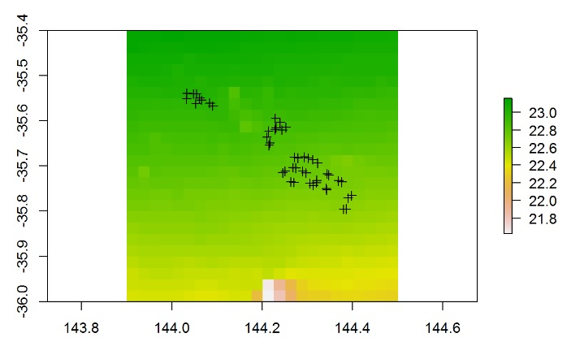

```{r}
#| include: false
set.seed(1)
```

R has a very wide range of functions and packages for visualising data.

These pages have a brief introduction to:

* [Basic plotting in R](ggplot.qmd)
* [More advanced plotting with ggplot](ggplot.qmd)
* [Visualising multivariate data](#visualising-multivariate-data)
* [Visualising spatial data (incl. mapping)](#visualising-spatial-data)

## Visualising multivariate data

```{r}
#| label: multivariate-vis-1
#| echo: false
#| fig-width: 8
#| fig-height: 4
#| warning: false
#| message: false

Herbivores <- read.csv(file = "data/Herbivore_specialisation.csv", header = TRUE)

par(mfrow = c(1, 2))

# MDS ordination

Habitat <- Herbivores$Habitat
Herb_community <- Herbivores[, 4:10]
library(vegan)
Herb_community.mds <- metaMDS(comm = Herb_community, distance = "bray", trace = FALSE)
plot(Herb_community.mds$points, col = as.factor(Habitat), pch = 16, xlab = "", ylab = "", xaxt = "n", yaxt = "n")

# Cluster diagram

library(dendextend)
Harbour_metals <- read.csv(file = "data/Harbour_metals.csv", header = TRUE)
Harbour_metals2 <- Harbour_metals[, 4:8]
rownames(Harbour_metals2) <- Harbour_metals$Rep
H_metals.sim <- dist(Harbour_metals2, method = "euclidean")
H_metals.cluster <- hclust(H_metals.sim, method = "single")
dend <- as.dendrogram(H_metals.cluster)
sample_colours <- as.numeric(Harbour_metals$Location)
sample_colours <- sample_colours[order.dendrogram(dend)]
labels_colors(dend) <- sample_colours
plot(dend, ylab = "")
```

R has a very wide range of functions and packages for visualising multivariate data. Here is some help for some of the more commonly used techniques:  

* [multidimensional scaling](../statistical-methods/mds.qmd)  
* [principal componenents analysis](pca.qmd)  
* [cluster analysis](../statistical-methods/cluster-analysis.qmd)  

## Visualising spatial data

R has a very wide range of functions and packages for visualising spatial data. This page will link to a series of tutorials for handling spatial data and making maps.  

* [Making simple maps with ggmap](simple-maps.qmd)  
* [Making maps from shapefiles]
* More soon...


