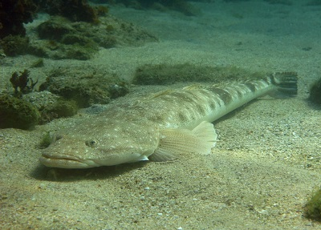
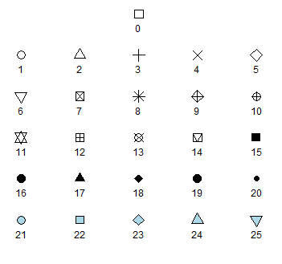
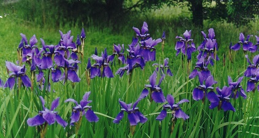
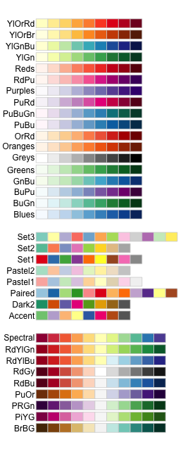

```{r}
#| label: basic-plotting-1
#| echo: false
#| fig-width: 6
#| fig-height: 2.5
Plant_height <- read.csv(file = "data/Plant_height.csv", header = TRUE)

par(mfrow = c(1, 3))

hist(Plant_height$height, main = NULL, xlab = "Plant heigth (cm)", col = "red")

model <- lm(loght ~ temp, data = Plant_height)
plot(loght ~ temp, data = Plant_height, xlab = "Temperature (C)", ylab = "log(Plant height)", pch = 16, col = "darkgreen")
abline(model, col = "red")

boxplot(loght ~ hemisphere, data = Plant_height, ylab = "log(Plant height)", xlab = "Hemisphere", names = c("South", "North"), col = "lightblue")
```

R has a very wide range of functions and packages for visualising data. Here is some help for some very simple plots using the base functions in R for data with:  

* [one continuous variable](#one-continuous-variable) - histograms and box plots  
* [two continuous variables](#two-continuous-variables) - scatter plots  
* [one continuous vs categorical variables](#one-continuous-and-one-categorical-variable) - box plots and bar plots  

## One continuous variable

Being able to visualise the properties of data is a critical step in data exploration and needed for effective communication of results. This page details two common ways that you can display data from a single continuous variable in R: frequency histograms and box-and-whisker plots.

The sample data used below are the lengths (cm) of 80 fish caught in an estuary at sites with different management zones (protected versus unprotected) and shores (urbanised versus healthy).



### Frequency histograms

Frequency histograms plot how often the values of a continuous variable fall into certain ranges. They are an effective way to visualise the range of values obtained and the distribution of your data (i.e. is it symmetrical or skewed?).

Firstly, download the sample data set  [Estuary_fish.csv](../../datasets/Estuary_fish.csv), and import into R.

```{r}
#| label: basic-plotting-one-continuous-1
Fish <- read.csv(file = "data/Estuary_fish.csv")
```

A frequency histogram of the variable Length from the data frame Fish is easily produced with the `hist` function.

```{r}
#| label: basic-plotting-one-continuous-2
hist(Fish$Length)
```

You can see straight away that all the fish were less than 30 cm long and that these length data are positively skewed - small fish are more frequent and large fish are rare.

You can alter the number of bins or the range of each bin with `breaks` argument. This will change the width and shape of the histogram. For example, if you wanted 15 bins, you would use:

```{r}
#| label: basic-plotting-one-continuous-3
hist(Fish$Length, breaks = 15)
```

If you wanted each bin to be have a range of 2 cm, you would use `breaks=seq(0,30,by=2)` where the numbers in the brackets are the minimum, maximum and range for each bin.

### Box and whisker plots

A box and whisker plot, or boxplot, is another useful way to visualise the distribution of a single, continuous variable. They are easily made with the `boxplot` function. The `horizontal=TRUE` argument makes the single axis horizontal.

```{r}
#| label: basic-plotting-one-continuous-4
boxplot(Fish$Length, horizontal = TRUE)
```

The plot shows the distribution of a variable by indicating the median, quartiles, maximum and minimum of a variable. The top and bottom whiskers are the maximum and minimum values (excluding any outliers that are indicated by a circle). The thick black line is the median, with the boxes either side of the median line the lower and upper quartiles.

Remember that the median is the value that has 50% of values larger and 50% of values smaller. Similarly, the quartiles represent the values with 25% of the values lower (the lower quartile) or 25% of values higher (the upper quartile). 

The boxplot will indicate skewness in your data if the median is not equally distant from the quartiles or maximum and minimum values. In this example, you can see that the median is closer to the minimum value than the maximum (indicating that low values are more common).

### Formatting plots

These simple plots can be formatted using the basic R formatting in the graphics package. The code below gives you some of the more commonly used formatting commands to give you higher control over your plots.

**Add axis labels or titles**

Axis labels are produced with the `xlab` and `ylab` arguments. Titles are provided with the `main` argument.

```{r}
#| label: basic-plotting-one-continuous-5
hist(Fish$Length, xlab = "Fish length (cm)", main = "Frequency histogram of fish length")

boxplot(Fish$Length, xlab = "Fish length (cm)", main = "Box plot of fish length", horizontal = TRUE)
```

Using the `main=NULL` argument removes the title, which is often unnecessary as details of what a plot illustrates are usually written in a figure legend below the plot.

**Edit axis limits**

Axis limits are set by the `xlim` and `ylim` arguments, where a vector of the minimum and maximum limits is required. For example, to have each of these plot the data between 0 and 40, you would use:

```{r, eval = FALSE}
#| label: basic-plotting-one-continuous-6
hist(Fish$Length, xlab = "Fish length (cm)", main = "Frequency histogram of fish length", xlim = c(0, 40))

boxplot(Fish$Length, xlab = "Fish length (cm)", main = "Box plot of fish length", ylim = c(0, 40), horizontal = TRUE)
```

Note that `ylim' is needed here to set the range for the single response variable (Fish length) even though it ends up on the horizontal axis after we use the `horizontal=TRUE` argument.

**Plot alignment**

Use the `horizontal=TRUE` argument to align the box plot horizontally - leave this out if you want a vertical alignment.

**Adding colour**

Colour can be added to any part of the plots (axis, fonts etc.) using the `col` argument. There are over 600 colours that can be plotted; type `colors()` for the names of the whole range.

Here we will simply change the colour of the histogram.

```{r}
#| label: basic-plotting-one-continuous-7
hist(Fish$Length, xlab = "Fish length (cm)", main = "Frequency histogram of fish length", col = "red")
```

### Further help

Type `?hist` and `?boxplot` to get the R help for these functions. 

**Author**: Stephanie Brodie

**Year:** 2016

## Two continuous variables

Visualising the relationship between two continuous variables is one of the most commonly used graphical techniques in the sciences. This page details how to produce simple scatterplots to display how one continuous variable is related to another.


For this worked example, download a data set on plant heights around the world, [Plant_height.csv](../../datasets/Plant_height.csv), and import into R.

```{r}
#| label: basic-plotting-two-continuous-1
Plant_height <- read.csv(file = "data/Plant_height.csv", header = TRUE)
```

### Scatterplots

### Scatterplots###

To visualise how plant height varies with temperature, we can use a simple scatterplot, using the `plot` function. Place the Y variable on the left of the tilde (~) and the X variable on the right. The `data=Plant_height` argument tells R to look in the data frame Plant_height for those two variables.

```{r}
#| label: basic-plotting-two-continuous-2
plot(height ~ temp, data = Plant_height)
```

If the two variables you would like to plot are in different objects in R, you would simply use:

```{r, eval=F}
#| label: basic-plotting-two-continuous-3
plot(y ~ x)
```

where *y* and *X* are two vectors of equal length. 

### Formatting plots

Scatterplots can be formatted using the basic R formatting in the graphics package. The code below details some of the more commonly used formatting commands for simple scatterplots. These commands can be used for any plotting function in the graphics package.

**Add axis labels or titles**
Axis labels are produced with the `xlab` and `ylab` arguments. Titles are provided with the `main` argument. Note that figures in scientific publications rarely have a title, but include information about the plot in a figure legend presented below the plot.

```{r}
#| label: basic-plotting-two-continuous-4
plot(height ~ temp, data = Plant_height, xlab = "Temperature (°C)", ylab = "Plant height (m)", main = "Plant height vs temperature")
```

**Edit axis limits**
Axis limits are set by the `xlim` and `ylim` arguments, where a vector of the minimum and maximum limits is required. For example to set the Y axis to have a minimum of zero and a maximum of 80 m, and the x axis to range between -20 and 30, use:

```{r,eval=FALSE}
#| label: basic-plotting-two-continuous-5
plot(height ~ temp, data = Plant_height, xlab = "Temperature (°C)", ylab = "Plant height (m)", ylim = c(0, 80), xlim = c(-20, 30))
```

**Symbol style**
The choice of symbols to use in plotting is extensive and choices are accessed using the `pch` argument in the graphical parameters. Type `?pch` to see all the choices. 



A solid circles `pch=16` or `pch=19` are often the neatest way to display data on a scatterplot.

```{r}
#| label: basic-plotting-two-continuous-6
plot(height ~ temp, data = Plant_height, xlab = "Temperature (°C)", ylab = "Plant height (m)", ylim = c(0, 80), pch = 16)
```

**Adding colour**

Colour can be added to any part of the plots (axis, fonts etc.) using `col` argument. There are over 600 colours that can be plotted, type `colours()` for the whole range.

Here we will simply change the colour of the symbols to blue.

```{r}
#| label: basic-plotting-two-continuous-7
plot(height ~ temp, data = Plant_height, xlab = "Temperature (°C)", ylab = "Plant height (m)", pch = 16, col = "blue")
```

**Adding a line of best fit**

To further explore the relationship between two variables you can add a line of best fit. For example, to add the line of best fit from a simple linear regression, we would use the linear modelling function, `lm`, to obtain the slope and intercept, and add this line to the scatterplot via the graphical parameter `abline`.

See the page on [linear regression](../statistical-methods/linear-regression.qmd) for the analysis of tree height versus temperature for this data set. The dependent variable analysed was the log transformed data for tree height (loght). To plot this against temperature with the line of best fit from the linear model, we would use:

```{r}
#| label: basic-plotting-two-continuous-8
plot(loght ~ temp, data = Plant_height, xlab = "Temperature (°C)", ylab = "log(Plant height)", pch = 16)
abline(lm(loght ~ temp, data = Plant_height))
```

### Further help

Type `?plot` and `?abline` to get the R help for these functions. 

**Authors**: Stephanie Brodie & Alistair Poore

**Year:** 2016

## One continuous and one categorical variable

Visualising how a measured variable relates to other variables of interest is essential for data exploration and communicating the results of scientific research. This page details how to plot a single, continuous variable against levels of a categorical predictor variable. 

These sorts of plots are very commonly used in the biological, earth and environmental sciences. For example, to view how a given variable differs between an experimental treatment and a control, or among sites and sampling times in environmental sampling. 


We will use sample data from an experiment that contrasted the metabolic rate of two species of prawns and introduce two commonly used types of plots for this purpose: boxplots and bar plots.

Firstly, download the sample data file, [Prawns_MR.csv](../../datasets/Prawns_MR.csv), and import into R.

```{r}
#| label: basic-plotting-one-continuous-one-factor-1
Prawns <- read.csv(file = "data/Prawns_MR.csv")
```

### Boxplots

Boxplots are easily made with the `boxplot` function. Boxplots show the distribution of a variable by indicating the median, quartiles, maximum and minimum of a variable. The top and bottom whiskers are the maximum and minimum values (excluding any outliers that are indicated by a circle). The thick black line is the median, with the boxes either side of the median line the lower and upper quartiles.

To contrast metabolic rate across the two species, we would use:

```{r}
#| label: basic-plotting-one-continuous-one-factor-2
boxplot(Metabolic_rate ~ Species, data = Prawns)
```

The continuous variable is on the left of the tilde (~) and the categorical variable is on the right. Straight away you can see that species B has a higher metabolic rate than species A.

### Bar plots

These sorts of data are also commonly visualised with a bar plot that displays the means of the continuous variable for each level of the categorical variable, with error bars displaying some measures of variation within each category. The error bars could be the standard deviation, standard error or 95% confidence intervals.

While commonly used, they are not so easy to create in the base functions in R. There are various ways to do this, but one is to use the `summarise` and `group_by` functions from the package [dplyr](https://cran.r-project.org/web/packages/dplyr/index.html) to calculate the means and measures of variation for each level of your categorical variable (see [Summarising data](../data-literacy/summarising-tables/index.qmd)).

Here is some sample code to plot means +/- standard deviations. For more control over error bars, we recommend using the more advanced plotting options in the package ggplot2 (see [bar plots with error bars](#bar-plots-with-error-bars)).

```{r}
#| label: one-continuous-one-factor-3
#| warning: false
#| message: false
library(dplyr)

Species.summary <- Prawns %>% # the names of the new data frame and the data frame to be summarised
  group_by(Species) %>% # the grouping variable
  summarise(
    mean = mean(Metabolic_rate), # calculates the mean
    sd = sd(Metabolic_rate), # calculates the standard deviation
    lower = mean(Metabolic_rate) - sd(Metabolic_rate),
    upper = mean(Metabolic_rate) + sd(Metabolic_rate)
  )
```

In a new data frame called Species.summary, we now have the means, standard deviations and the lower and upper values that set the size of the error bars for each level of the grouping variable. The  limits for the error bars were calculated by adding (upper) or subtracting (lower) the standard deviation from the mean.

We can now use the `barplot` and `arrows` functions to make a plot with error bars.

```{r}
#| label: basic-plotting-one-continuous-one-factor-4
Prawn.plot <- barplot(Species.summary$mean,
  names.arg = Species.summary$Species,
  ylab = "Metabolic rate", xlab = "Species", ylim = c(0, 1)
)

arrows(Prawn.plot, Species.summary$lower, Prawn.plot, Species.summary$upper, angle = 90, code = 3)
```

Note that plots of means and error bars can be misleading as they hide the true distributions of the data. Means can also be misleading when data are very skewed, and calculations for error bars using *t* statistics (e.g., 95% confidence intervals) assume the data are normally distributed. 

### Formatting plots

Box plots and bar plots can be formatted using the basic R formatting in the base graphics package. The code below details some of the more commonly used formatting commands for these plots. These commands can be used for any plotting function in the graphics package.

**Add axis labels or titles**  
Axis labels are produced with the `xlab` and `ylab` arguments. Titles are provided with the `main` argument. Note that figures in scientific publications rarely have a title, but include information about the plot in a figure legend presented below the plot.

```{r,eval=FALSE}
#| label: basic-plotting-one-continuous-one-factor-5
boxplot(Metabolic_rate ~ Species, data = Prawns, xlab = "Species", ylab = "Metabolic rate")
```

**Edit axis limits**  
Axis limits are set by the `xlim` and `ylim` arguments, where a vector of the minimum and maximum limits is required. For example to set the Y axis to have a minimum of zero and a maximum of 1, use:

```{r,eval=FALSE}
#| label: basic-plotting-one-continuous-one-factor-6
boxplot(Metabolic_rate ~ Species,
  data = Prawns, xlab = "Species", ylab = "Metabolic rate",
  ylim = c(0, 1)
)
```

**Renaming levels of the categorical factor**  
If the levels of your categorical factor are not ideal for the plot, you can rename those with the 
`names` argument. For example, to put the actual species names on:

```{r}
#| label: basic-plotting-one-continuous-one-factor-7
boxplot(Metabolic_rate ~ Species,
  data = Prawns, xlab = "Species", ylab = "Metabolic rate",
  names = c("Penaeus monodon", "Fenneropenaeus merguiensis")
)
```

**Adding colour** 
Colour can be added to any part of the plots (axis, fonts etc.) using `col` argument. There are over 600 colours that can be plotted, type `colours()` for the whole range.

Here we will simply change the colour of the bars in the bar plot to red.

```{r}
#| label: basic-plotting-one-continuous-one-factor-8
barplot(Species.summary$mean,
  names.arg = Species.summary$Species,
  ylab = "Metabolic rate", xlab = "Species", ylim = c(0, 1), col = "red"
)
```

### Further help

Type `?boxplot` and `?barplot` to get the R help for these functions. 

**Authors**: Stephanie Brodie & Alistair Poore

**Year:** 2016

## Introduction to ggplot2

```{r, echo=FALSE, warning=F}
#| label: ggplot-1
library(ggplot2)
g1 <- ggplot(iris, aes(Sepal.Length, Petal.Length, colour = Species)) +
  geom_point() +
  theme_classic()
print(g1 + labs(y = "Petal length (cm)", x = "Sepal length (cm)"))
```

[ggplot2](https://ggplot2.tidyverse.org) is a powerful graphing package in R that can be used to create professional looking plot for reports, essays or papers. It can create a variety of plots including boxplots, scatterpots and histograms and they can be highly customised to suit your data. 

The package is named after a book called [The Grammar of Graphics](https://books.google.com.au/books/about/The_Grammar_of_Graphics.html?id=ZiwLCAAAQBAJ&source=kp_cover&hl=en) about how to effectively communicate data graphically. 

Start with the [basics](#introduction-to-ggplot2) to learn the basic syntax of making a graph

Then, visit our other pages to further customise the aesthetics of the graph, including colour and formatting:

* [altering the overall appearance](#customising-your-ggplot)
* [adding titles and axis names](#titles-and-axis-labels)
* [colours and symbols](#colours-and-shapes)
* [multipanel figures](multi-panel-figures.qmd).

Help on all the ggplot functions can be found at the [The master ggplot help site](https://ggplot2.tidyverse.org).

A useful cheat sheet on commonly used functions can be downloaded [here](https://raw.githubusercontent.com/rstudio/cheatsheets/main/data-visualization.pdf).

<p style="margin-left: .5in; text-indent: -.5in;">Chang, W (2012) *R Graphics cookbook.* O'Reilly Media. - a guide to ggplot with quite a bit of help online [here](http://www.cookbook-r.com/Graphs/)</p>

**Year:** 2016

```{r}
#| label: ggplot-basics-1
#| echo: false
#| warning: false
library(ggplot2)
g1 <- ggplot(iris, aes(Sepal.Length, Petal.Length, colour = Species)) +
  geom_point() +
  theme_classic()
print(g1 + labs(y = "Petal length (cm)", x = "Sepal length (cm)"))
```

### Creating a ggplot

First, you will need to install the package ggplot2 on your machine, then load the package with the usual `library` function.

```{r}
#| label: ggplot-2
library(ggplot2)
```

The starting point for creating a plot is to use the `ggplot` function with the following basic structure:

```{r,eval=FALSE}
#| label: ggplot-3
plot1 <- ggplot(data, aes(x_variable, y_variable)) +
  geom_graph.type()

print(plot1)
```

`data` is a data frame that holds the variables that you would like to plot.

`aes` specifies which variables to plot. This code commonly causes confusion when creating ggplots. While `aes` stands for aesthetics, in ggplot it does not relate to the visual look of the graph but rather what data you want to see in the graph. It specifies what the graph presents rather than how it is presented.

`+ geom_graph.type` specifies what sort of plot you want to make. ggplot will not work unless you have this added on. You don't actually type 'graph.type()', but choose one of the types of graph.

Commonly used examples include:  

* scatterplot - `+ geom_point()`  
* boxplot - `+ geom_boxplot()`  
* histogram - `+ geom_histogram()`  
* bar plot - `+ geom_bar()`  

Ensure there is a open and closed bracket after the `geom` code. This tells R to make the graph with the basic standard formatting for this graph type.

The type of graph you want to make has to match the classes of the inputs. For example, a scatterplot would require both variables to be numeric. Or a boxplot would require the *x* variable to be a factor and the *y* variable to be numeric. You can check the class of any variable with the `class` function, or all variables in a data frame with the `str` function.

A helpful practise when making ggplots is to assign the plot you've made to an object (e.g., plot1 in the code above) and then 'print' it separately. As your ggplot becomes more complicated this will make it much easier. 

### Example plots



In these examples, let's use a data set that is already in R with the length and width of floral parts for three species of iris. First, load the data set:

```{r}
#| label: ggplot-4
data(iris)
```

To contrast petal length across the three species of iris with a **box plot**, we would use:

```{r}
#| label: ggplot-5
plot1 <- ggplot(iris, aes(Species, Petal.Length)) +
  geom_boxplot()
print(plot1)
```

Note how `aes` included the *x* then the *y* variables which you wanted to plot, and that `+ geom_boxplot()` specified a boxplot.

To plot a **frequency histogram** of petal length, we would use:

```{r, message=F}
#| label: ggplot-6
plot2 <- ggplot(iris, aes(Petal.Length)) +
  geom_histogram()
print(plot2)
```

To use a **scatter plot** the visualise the relationship between petal length and sepal length, we would use:

```{r}
#| label: ggplot-7
plot3 <- ggplot(iris, aes(Sepal.Length, Petal.Length)) +
  geom_point()
print(plot3)
```

These points could then be coloured according to the levels of a categorical variable. To do this, add `colour="categorical.variable"` in the `aes` brackets. To colour by species, we would use:

```{r}
#| label: ggplot-8
plot4 <- ggplot(iris, aes(Sepal.Length, Petal.Length, colour = Species)) +
  geom_point()
print(plot4)
```

### Adding a basic theme

The overall look of the ggplot can be altered with different set themes. This can be done by adding `+ theme_bw()` or `+ theme_classic()` to the end of your line of code. Like `geom()`, ensure there is open and closed brackets after the theme name.

```{r}
#| label: ggplot-9
plot5 <- ggplot(iris, aes(Sepal.Length, Petal.Length, colour = Species)) +
  geom_point() +
  theme_bw()
print(plot5)

plot6 <- ggplot(iris, aes(Sepal.Length, Petal.Length, colour = Species)) +
  geom_point() +
  theme_classic()
print(plot6)
```

### Further help

To further customise the aesthetics of the graph, including colour and formatting, see our other ggplot help pages:  

* [altering the overall appearance](#customising-your-ggplot)  
* [adding titles and axis names](#titles-and-axis-labels)  
* [colours and symbols](#colours-and-shapes).   

Help on all the ggplot functions can be found at the [The master ggplot help site](https://ggplot2.tidyverse.org).

A useful cheat sheet on commonly used functions can be downloaded [here](https://raw.githubusercontent.com/rstudio/cheatsheets/main/data-visualization.pdf).

<p style="margin-left: .5in; text-indent: -.5in;">Chang, W (2012) *R Graphics cookbook.* O'Reilly Media. - a guide to ggplot with quite a bit of help online [here](http://www.cookbook-r.com/Graphs/)</p>

**Author**: Fiona Robinson

**Year:** 2016

## Titles and axis labels

**ggplots** are almost entirely customisable. This gives you the freedom to create a plot design that perfectly matches your report, essay or paper. 

This page provides help for adding titles, legends and axis labels.

Before you get started, read the page on the [basics](#introduction-to-ggplot2) of plotting with ggplot and install the package ggplot2.

```{r}
#| label: ggplot-labels-1
#| warning: false
library(ggplot2)
```


In these examples, let's use a data set that is already in R with the length and width of floral parts for three species of iris. First, load the data set:

```{r}
#| label: ggplot-labels-2
data(iris)
```

The following code for a scatter plot of petal length vs sepal length with the three species colour-coded is the base that we will use throughout this tutorial:

```{r, echo=TRUE}
#| label: ggplot-labels-3
IrisPlot <- ggplot(iris, aes(Sepal.Length, Petal.Length, colour = Species)) +
  geom_point()
```

```{r,echo=F}
#| label: ggplot-labels-4
print(IrisPlot)
```

### Adding a title

To add a title to your plot, add the code `+ggtitle("Your Title Here")` to your line of basic ggplot code. Ensure you have quotation marks at the start and end of your title. 

```{r echo=TRUE}
#| label: ggplot-labels-5
print(IrisPlot + ggtitle("Petal and sepal length of iris"))
```

If you have a particulary long title that would work better on two lines, use `\n` for a new line. Make sure to use the correct slash. 

```{r echo=TRUE}
#| label: ggplot-labels-6
print(IrisPlot + ggtitle("Petal and sepal length \nof three species of iris"))
```

### Changing axis labels

To alter the labels on the axis, add the code `+labs(y= "y axis name", x = "x axis name")` to your line of basic ggplot code.

```{r echo=TRUE}
#| label: ggplot-labels-7
print(IrisPlot + labs(y = "Petal length (cm)", x = "Sepal length (cm)"))
```

Note: You can also use `+labs(title = "Title")` which is equivalent to `ggtitle`.

For example:

```{r eval=F}
#| label: ggplot-labels-8
print(IrisPlot + labs(
  title = "Petal and Sepal Length \nof Iris",
  y = "Petal Length (cm)", x = "Sepal Length (cm)"
))
```

### Changing the legend title

In the same way you edited the title and axis names, you can alter the legend title by adding `+labs(colour = "Legend Title")` to the end of your basic plot code. Note: This will only works if you have actually added an extra variable to your basic `aes` code (in this case, using `colour=Species` to group the points by Species).

```{r}
#| label: ggplot-labels-9
IrisPlot <- ggplot(iris, aes(Sepal.Length, Petal.Length, colour = Species)) +
  geom_point()

print(IrisPlot + labs(colour = "Iris species"))
```

Note: If you are using a histogram, boxplot or bar graph then it is slightly different. You must use `fill` instead of `colour`.

```{r,eval =F}
#| label: ggplot-labels-10
IrisBox <- ggplot(iris, aes(Species, Sepal.Length, fill = Species)) +
  geom_boxplot()
print(IrisBox + labs(fill = "Iris species"))
```

### Altering the text style of your legend, axis or title

The font, colour, size and emphasis of your labels and text can all be altered. To do this, use the code `theme()` and customise with `element_text()` to alter these properties. 

The basic format is: `mytheme <- theme(title type = element_text(your formats))`

Where "title type" specifies which particular text you want to edit. These can be:

* plot title. - `plot.title = element_text()`  
* axis title. - `axis.title = element_text()`  
* legend title. - `legend.title = element_text()`  
* legend categories - `legend.text = element_text()`  
* appearance of axis values/numbers. - `axis.text = element_text()`  

**Formatting choices**
The font, colour, size and emphasis of any of these labels can be altered by arguments within `element_text(your format)`. 

* family. - the font style. Examples of fonts include: "Palatino", "Helvetica", "Courier", "Times". Further font choices can be seen 
[here](http://www.cookbook-r.com/Graphs/Fonts/). For example, `family = "Palatino"`  
* face. - the type of emphasis, with options including **bold**, *italic* and "bold.italic". For example, `face = "bold.italic"`  
* colour. - the colour can be changed to any of the colours listed [here](http://www.stat.columbia.edu/~tzheng/files/Rcolor.pdf). Remember to include "" before and after the colour name. For example, `colour = "steelblue2"`.  
* size. - the size of the text. This is specified by entering a number. For example, `size = (3)`.  

### Example code

Here is an example of a theme that customises the title, the legend, the axis labels and specifies the font, emphasis, size and colour of each of these. The figure is then plotted with this theme and further code that provides the content of the title and axis labels:

```{r,warning=F}
#| label: ggplot-labels-11
mynamestheme <- theme(
  plot.title = element_text(family = "Helvetica", face = "bold", size = (15)),
  legend.title = element_text(colour = "steelblue", face = "bold.italic", family = "Helvetica"),
  legend.text = element_text(face = "italic", colour = "steelblue4", family = "Helvetica"),
  axis.title = element_text(family = "Helvetica", size = (10), colour = "steelblue4"),
  axis.text = element_text(family = "Courier", colour = "cornflowerblue", size = (10))
)

print(IrisPlot + mynamestheme + labs(title = "Petal and sepal \nlength of iris", y = "Petal length (cm)", x = "Sepal length (cm)"))
```

### Removing a label

Another option is to remove the text from the plot entirely. To do this you use the code `= element_blank()`, remembering those open and closed brackets. The following code would remove the legend title and axis text.

```{r,eval=F}
#| label: ggplot-labels-12
myblanktheme <- theme(
  plot.title = element_text(family = "Helvetica", face = "bold", size = (15)),
  legend.title = element_blank(),
  legend.text = element_text(face = "italic", colour = "steelblue4", family = "Helvetica"),
  axis.title = element_text(family = "Helvetica", size = (10), colour = "steelblue4"),
  axis.text = element_blank()
)

print(IrisPlot + myblanktheme + labs(title = "Petal and sepal \nlength of iris", y = "Petal length (cm)", x = "Sepal length (cm)"))
```

### Further help

To further customise the aesthetics of the graph, including colour and formatting, see our other ggplot help pages:  

* [altering overall appearance](#customising-your-ggplot).  
* [colours and symbols](#colours-and-shapes).

Help on all the ggplot functions can be found at the [The master ggplot help site](https://ggplot2.tidyverse.org).

A useful cheat sheet on commonly used functions can be downloaded [here](https://raw.githubusercontent.com/rstudio/cheatsheets/main/data-visualization.pdf).

<p style="margin-left: .5in; text-indent: -.5in;">Chang, W (2012) *R Graphics cookbook.* O'Reilly Media. - a guide to ggplot with quite a bit of help online [here](http://www.cookbook-r.com/Graphs/)</p>

**Author**: Fiona Robinson

**Year:** 2016

## Colours and shapes

Before you get started, read the page on the [basics](#introduction-to-ggplot2) of plotting with ggplot and install the package ggplot2.

```{r}
#| label: ggplot-colour-shapes-1
#| warning: false
library(ggplot2)
```


In these examples, let's use a data set that is already in R with the length and width of floral parts for three species of iris. First, load the data set:

```{r}
#| label: ggplot-colour-shapes-2
data(iris)
```

The following plots will be used as the base code throughout of this tutorial  

* a scatter plot of petal length vs sepal length  
* a box plot of sepal length vs species  
* a frequency histogram of sepal length  

```{r, echo=TRUE, message=F, warning=F}
#| label: ggplot-colour-shapes-3
IrisPlot <- ggplot(iris, aes(Sepal.Length, Petal.Length)) +
  geom_point()

IrisBox <- ggplot(iris, aes(Species, Sepal.Length, fill = Species)) +
  geom_boxplot()

IrisHist <- ggplot(iris, aes(Sepal.Length)) +
  geom_histogram()
```

```{r,echo=F,message=F, warning=F}
#| label: ggplot-colour-shapes-4
library(gridExtra)
grid.arrange(IrisPlot, IrisBox, IrisHist, ncol = 2)
```

### Changing the colour of the whole plot or its outline

To colour your entire plot one colour, add `fill = "colour"` or `colour = "colour"` into the brackets following the `geom_...` code where you specified what type of graph you want. 

Note that for most plots, `fill = "colour"` will colour the whole shape, whereas `colour = "colour"` will fill in the outline.

For example, to make a blue box plot with a red outline, or a yellow histogram with an green outline::

```{r}
#| label: ggplot-colour-shapes-5
IrisBox <- ggplot(iris, aes(Species, Sepal.Length)) +
  geom_boxplot(fill = "blue", colour = "red")

IrisHist <- ggplot(iris, aes(Sepal.Length)) +
  geom_histogram(fill = "yellow", colour = "green")
```

```{r,echo=F,message=F, warning=F}
#| label: ggplot-colour-shapes-6
grid.arrange(IrisBox, IrisHist, ncol = 2)
```

For scatterplots, `colour = "colour"` will specify the fill colour for the point shape: 

```{r}
#| label: ggplot-colour-shapes-7
IrisPlot <- ggplot(iris, aes(Petal.Length, Sepal.Length)) +
  geom_point(colour = "red")
```

```{r}
#| label: ggplot-colour-shapes-8
#| echo: false
#| message: false
#| warning: false
print(IrisPlot)
```

The plots and outlines can be changed to any colour listed [here](http://www.stat.columbia.edu/~tzheng/files/Rcolor.pdf). Remember to include "" before and after the colour name. 

### Using colour to visualise additional variables

**Additional categorical variables**

If you wish to colour points on a **scatter plot** by a third categorical variable, then add `colour = variable.name` within your `aes` brackets. This tells ggplot that this third variable will colour the points. To colour the points by the variable Species:

```{r}
#| label: ggplot-colour-shapes-9
IrisPlot <- ggplot(iris, aes(Petal.Length, Sepal.Length, colour = Species)) +
  geom_point()
```

```{r}
#| label: ggplot-colour-shapes-10
#| echo: false
#| message: false
#| warning: false
print(IrisPlot)
```

To colour **box plots** or **bar plots** by a given categorical variable, you use you use `fill = variable.name` instead of `colour`.

```{r}
#| label: ggplot-colour-shapes-11
IrisBox <- ggplot(iris, aes(Species, Sepal.Length, fill = Species)) +
  geom_boxplot()
```

```{r}
#| label: ggplot-colour-shapes-12
#| echo: false
#| message: false
#| warning: false
print(IrisBox)
```

**Additional continuous variables**

The basic format for colouring a continuous variable is very similar to a categorical variable. The only real difference is you need to use `+ scale_colour_gradient(low = "colour1", high = "colour2")`. The other colour scales will not work as they are for categorical variables. For example, here is a plot of sepal length vs petal length, with the symbols colored by their value of sepal width.

```{r}
#| label: ggplot-colour-shapes-13
IrisPlot.continuous <- ggplot(iris, aes(Petal.Length, Sepal.Length, colour = Sepal.Width)) +
  geom_point()

print(IrisPlot.continuous)
```

To make the gradient more effective, specify two colours within the `+ scale_colour_gradient` brackets to represent either end of the gradient. For example: 

```{r}
#| label: ggplot-colour-shapes-14
print(IrisPlot.continuous + scale_colour_gradient(low = "black", high = "white"))

print(IrisPlot.continuous + scale_colour_gradient(low = "darkolivegreen1", high = "darkolivegreen"))
```

### Choosing your own colours for these variables

This can be done in numerous ways. The basic format is to add `+ scale_colour_yourchoice()` for scatter plots or `+ scale_fill_yourchoice()` for box plots to the code where you 'print' your graph, where `yourchoice()` is one of several options. The syntax is:

`print(your.basic.graph + your.theme + scale_colour_yourchoice())`

There are numerous options for the `+ scale_colour_yourchoice()` part.

**Individually select colours.**  To manually choose colours, you can use `+ scale_colour_manual()` or `+ scale_fill_manual()`. For example, to choose three colours for the iris plots:

```{r}
#| label: ggplot-colour-shapes-15
print(IrisPlot + scale_colour_manual(values = c("Blue", "Red", "Green")))

print(IrisBox + scale_fill_manual(values = c("Black", "Orange", "Brown")))
```

**Assign tones on a greyscale.** Use `+ scale_colour_grey()` or `+ scale_fill_grey()` 

```{r}
#| label: ggplot-colour-shapes-16
print(IrisPlot + scale_colour_grey())

print(IrisBox + scale_fill_grey())
```

**Assign colours from a pre-made pallette.** Use `+ scale_colour_brewer()` or `+ scale_fill_brewer`. To do this you will need to install the package [RColorBrewer](https://cran.r-project.org/web/packages/RColorBrewer/index.html) and load in R.

```{r, echo= TRUE, warning=F}
#| label: ggplot-colour-shapes-17
library(RColorBrewer)
```



This can then be added to the end of your graph code just like the others `+ scale_colour_brewer(palette = "chosen.palette")` for scatterplots and `+ scale_fill_brewer(palette = "chosen.palette")` for boxplots, where `"chosen.pallete"` is one of the available palletes. For example,

```{r}
#| label: ggplot-colour-shapes-18
print(IrisPlot + scale_colour_brewer(palette = "Dark2"))

print(IrisBox + scale_fill_brewer(palette = "Oranges"))
```

### Changing symbols in a scatterplot

In a simple scatterplot with no grouping variables, you can change the shape of the symbol by adding `shape = ?` to the `geom_point()` code, where ? is one of the following numbers for different shapes.


For example, to use a filled triangle:

```{r}
#| label: ggplot-colour-shapes-19
IrisPlot <- ggplot(iris, aes(Petal.Length, Sepal.Length)) +
  geom_point(shape = 17)
```

```{r}
#| label: ggplot-colour-shapes-20
#| echo: false
print(IrisPlot)
```

Different symbols can be used to group data in a scatterplot. This can be very helpful when printing in black and white or to further distinguish your categories. 

To do this, you need to add  `shape = variable.name` within your basic plot `aes` brackets, where `variable.name` is the name of your grouping variable. For example, to have different symbols for each species, we would use.

```{r}
#| label: ggplot-colour-shapes-21
IrisPlot.shape <- ggplot(iris, aes(Petal.Length, Sepal.Length, shape = Species)) +
  geom_point()
```

```{r}
#| label: ggplot-colour-shapes-22
#| echo: false
print(IrisPlot.shape)
```

To set the symbols manually, we can use the symbol codes in `scale_shape_manual()` added to your print function.

```{r}
#| label: ggplot-colour-shapes-23
print(IrisPlot.shape + scale_shape_manual(values = c(0, 16, 3)))
```

This can be used with colour to further distinguish and group your variables. 

```{r}
#| label: ggplot-colour-shapes-24
IrisPlot.shape <- ggplot(iris, aes(Petal.Length, Sepal.Length, shape = Species, colour = Species)) +
  geom_point()

print(IrisPlot.shape + scale_shape_manual(values = c(0, 16, 3)) + scale_colour_manual(values = c("chartreuse4", "chocolate", "slateblue4")))
```

### Further help

To further customise the aesthetics of the graph, including colour and formatting, see our other ggplot help pages:  
*[altering overall appearance](#customising-your-ggplot).  
*[adding titles and axis names](#titles-and-axis-labels)  

Help on all the ggplot functions can be found at the [The master ggplot help site](https://ggplot2.tidyverse.org).

A useful cheat sheet on commonly used functions can be downloaded [here](https://raw.githubusercontent.com/rstudio/cheatsheets/main/data-visualization.pdf).

<p style="margin-left: .5in; text-indent: -.5in;">Chang, W (2012) *R Graphics cookbook.* O'Reilly Media. - a guide to ggplot with quite a bit of help online [here](http://www.cookbook-r.com/Graphs/)</p>

**Author**: Fiona Robinson

**Year:** 2016

## Bar plots with error bars

Bar plots with error bars are very frequently used in the environmental sciences to represent the variation in a continuous variable within one or more categorical variables. These are not always straightforward to make with the base functions in R. This page introduces you to making these plots with the package ggplot2.

Before you get started, read the page on the [basics](#introduction-to-ggplot2) of plotting with ggplot and install the package ggplot2.

```{r}
#| label: ggplot-barplot-1
#| warning: false
library(ggplot2)
```


In this examples, let's use a data set that is already in R with the length and width of floral parts for three species of iris. First, load the data set:

```{r}
#| label: ggplot-barplot-2
data(iris)
```

To contrast a variable across species, we first need to summarise the data to obtain means and a measure of variation for each of the three species in the data set. There are several ways to do this in R, but we like the `summarise` and `group_by` functions in the package [dplyr](https://cran.r-project.org/web/packages/dplyr/index.html). See [here](../data-literacy/summarising-tables/index.qmd)for more details on using dplyr for summarising data.

The following code will make a new data frame with the summary data per species.

```{r}
#| label: ggplot-barplot-3
#| warning: false
#| message: false
library(dplyr)

Iris_summary <- iris %>% # the names of the new data frame and the data frame to be summarised
  group_by(Species) %>% # the grouping variable
  summarise(
    mean_PL = mean(Petal.Length), # calculates the mean of each group
    sd_PL = sd(Petal.Length), # calculates the standard deviation of each group
    n_PL = n(), # calculates the sample size per group
    SE_PL = sd(Petal.Length) / sqrt(n())
  ) # calculates the standard error of each group
```

We can now make a bar plot of means vs species, with standard deviations or standard errors as the error bar. The following code uses the standard deviations.

```{r}
#| label: ggplot-barplot-4
IrisPlot <- ggplot(Iris_summary, aes(Species, mean_PL)) +
  geom_col() +
  geom_errorbar(aes(ymin = mean_PL - sd_PL, ymax = mean_PL + sd_PL), width = 0.2)

IrisPlot + labs(y = "Petal length (cm) +/- s.d.", x = "Species") + theme_classic()
```

`geom_col` uses the value of the y variable (`mean_PL`) as the height of the bars.

In the `geom_errorbar` code, `ymin` and `ymax` are the top and bottom of the error bars (defined here as mean +/- sd), and `width` defines how wide the error bars are.

### Further help

To further customise the aesthetics of the graph, including colour and formatting, see our other ggplot help pages:  

* [altering the overall appearance](#customising-your-ggplot)  
* [adding titles and axis names](#titles-and-axis-labels)  
* [colours and symbols](#colours-and-shapes)   

Help on all the ggplot functions can be found at the [The master ggplot help site](https://ggplot2.tidyverse.org).

A useful cheat sheet on commonly used functions can be downloaded [here](https://raw.githubusercontent.com/rstudio/cheatsheets/main/data-visualization.pdf).

<p style="margin-left: .5in; text-indent: -.5in;">Chang, W (2012) *R Graphics cookbook.* O'Reilly Media. - a guide to ggplot with online help on making bar and line graphs with error bars [here](http://www.cookbook-r.com/Graphs/Bar_and_line_graphs_(ggplot2)/)</p>

**Author**: Alistair Poore (small edits by Will Cornwell)

**Year:** 2016

## Customising your ggplot

```{r}
#| label: ggplot-appearance-1
#| echo: false
#| warning: false
library(ggplot2)

g1 <-
  ggplot(iris, aes(Sepal.Length, Petal.Length, colour = Species)) +
  geom_point()

IrisBox <-
  ggplot(iris, aes(Species, Sepal.Length, fill = Species)) +
  geom_boxplot()

mytheme1 <-
  theme(
    legend.text = element_text(family = "Palatino", size = rel(1)),
    axis.title.y = element_text(colour = "black", family = "Palatino"),
    axis.title.x = element_blank(),
    axis.text = element_text(
      family = "Palatino",
      colour = "black",
      size = rel(1.1)
    ),
    axis.line = element_line(size = 0.5, colour = "grey"),
    panel.grid.major = element_blank(),
    panel.grid.minor = element_blank(),
    panel.background = element_rect(fill = "white"),
    legend.key = element_rect(fill = "white"),
    legend.title = element_text(
      colour = "black",
      size = rel(1.1),
      face = "bold",
      family = "Palatino"
    ),
    plot.title = element_text(
      face = "bold",
      size = rel(1.7),
      family = "Palatino"
    )
  )

print(
  IrisBox + mytheme1 + labs(y = "Sepal length (cm)") + scale_fill_manual(
    name = "Species",
    values = c("maroon3", "sienna1", "chartreuse4")
  )
)
```

**ggplots** are almost entirely customisable. This gives you the freedom to create a plot design that perfectly matches your report, essay or paper. 

The overall appearance can be edited by changing the style or prescence of grid lines, axis notches, panel colour, legend colour or outlines.

Before you get started, read the page on the [basics](#introduction-to-ggplot2) of plotting with ggplot and install the package ggplot2.

```{r}
#| label: ggplot-appearance-2
library(ggplot2)
```

### Creating a customised theme

One of the most effective ways to customise your plot is to create a customised theme and separate this from your basic ggplot code. By separating and saving your theme, it will be much easier to edit, alter and reuse for other projects.  


In these examples, let's use a data set that is already in R with the length and width of floral parts for three species of iris. First, load the data set:

```{r}
#| label: ggplot-appearance-3
data(iris)
```

The following code for a scatter plot of petal length vs sepal length with the three species colour-coded is the base that we will use throughout this tutorial.

```{r}
#| label: ggplot-appearance-4
#| echo: true
IrisPlot <- ggplot(iris, aes(Sepal.Length, Petal.Length, colour = Species)) +
  geom_point()
```

```{r}
#| label: ggplot-appearance-5
#| echo: false
print(IrisPlot)
```

To change the design of an element of your plot, you create a theme then print the plot with the theme applied. For example, some code to change the colour and size of the legend in the above plot would look like this.

```{r}
#| label: ggplot-appearance-6
mytheme <-
  theme(legend.title = element_text(colour = "steelblue", size = rel(2)))
```

We would then reprint the base plot with this theme added:

```{r}
#| label: ggplot-appearance-7
print(IrisPlot + mytheme)
```

Themes can have many different elements, that relate to legends, axes, titles etc. Separate each within the `theme` code with a comma. 

### Formatting the plot and legend background

The plot and legend background can be changed to any colour listed [here](http://www.stat.columbia.edu/~tzheng/files/Rcolor.pdf) using the following code:

* `panel.background = element_rect(your format)` will alters the panel behind the graph  
* `legend.key = element_rect(your format)` alters the boxes next to each category name  
* `legend.background = element_rect(your format)` will alters the box around the legend names and boxes.  

For each of these, the formats you can alter are:

* `fill = "colour"` to colour the panel behind the plot  
* `colour = "colour"` will alter the axis outline of the graph  
* `size = (number)` will alter the thickness of this outline  

To demonstrate how this works, here is a ugly theme with obvious colours chosen to demonstrate the differences: 

```{r}
#| label: ggplot-appearance-8
mytheme <-
  theme(
    panel.background = element_rect(fill = "black", colour = "yellow", size = 4),
    legend.key = element_rect(fill = "darkgrey", colour = "yellow"),
    legend.background = (element_rect(colour = "yellow", fill = "blue"))
  )

print(IrisPlot + mytheme)
```

### Altering the size, colour or presence of grid lines

The grid lines are divided into two sets of grid lines; major and minor. This allows you to accentuate or remove half the grid lines.  

* `panel.grid.major = element_line(your format)` - alters the format of major grid lines  
* `panel.grid.minor = element_line(your format)` - alters the format of minor grid lines  

where `(your format)` specifies the colour and thickness of the lines. 

Formats include:  

* Colour. For example, `colour = "steelblue2"` - remember to include "" before and after the colour name.  
* Size. Specified by entering a number, for example, `size = (3)`.  

Putting these together in a theme would look like this:

```{r}
#| label: ggplot-appearance-9
mytheme <-
  theme(
    panel.grid.major = element_line(colour = "black", size = (1.5)),
    panel.grid.minor = element_line(size = (0.2), colour = "grey")
  )

print(IrisPlot + mytheme)
```

To remove the grid lines, use the `element_blank()`.

```{r}
#| label: ggplot-appearance-10
mytheme <- theme(panel.grid.minor = element_blank(), panel.grid.major = element_blank())

print(IrisPlot + mytheme)
```

### Altering the x and y axis lines 

The size and colour of axis lines themselves can be customised in the same way as the grid lines (above), using `axis.line=element_line(your format)`. For example:

```{r}
#| label: ggplot-appearance-11
mytheme <-
  theme(
    axis.line = element_line(size = 1.5, colour = "red"),
    panel.background = element_rect(fill = "white")
  )

print(IrisPlot + mytheme)
```

### Altering the axis ticks/notches

The size and colour of the ticks can be altered using `axis.ticks = element_line(your format)`. For example:

```{r}
#| label: ggplot-appearance-12
mytheme <- theme(axis.ticks = element_line(colour = "red", size = (2)))

print(IrisPlot + mytheme)
```

### Removing any element of a theme

`= element_blank()` is used if you wish to entirely remove an element of the formatting. For example, to get rid of ticks, grid lines and the background, you would use:

```{r}
#| label: ggplot-appearance-13
mytheme <-
  theme(
    axis.ticks = element_blank(),
    panel.grid.minor = element_blank(),
    panel.grid.major = element_blank(),
    panel.background = element_blank()
  )

print(IrisPlot + mytheme)
```

### Example of a fully customised ggplot

Here is an example of a ggplot with many of the elements customised. This is obviously a lot of code, but remember that you can save and reuse your favorite theme as often as you like. See the page on [adding titles and axis names](#titles-and-axis-labels) for help with those parts of the `print()` code.

```{r, warning =F}
#| label: ggplot-appearance-14
IrisPlot <-
  ggplot(iris, aes(Sepal.Length, Petal.Length, colour = Species, shape = Species)) +
  geom_point()

mytheme3 <-
  theme(
    legend.text = element_text(face = "italic", colour = "steelblue4", family = "Helvetica", size = rel(1)),
    axis.title = element_text(colour = "steelblue4", family = "Helvetica", size = rel(1.5)),
    axis.text = element_text(family = "Helvetica", colour = "steelblue1", size = rel(1.5)),
    axis.line = element_line(size = 1, colour = "black"),
    axis.ticks = element_line(colour = "grey", size = rel(1.4)),
    panel.grid.major = element_line(colour = "grey", size = rel(0.5)),
    panel.grid.minor = element_blank(),
    panel.background = element_rect(fill = "whitesmoke"),
    legend.key = element_rect(fill = "whitesmoke"),
    legend.title = element_text(colour = "steelblue", size = rel(1.5), family = "Helvetica"),
    plot.title = element_text(colour = "steelblue4", face = "bold", size = rel(1.7), family = "Helvetica")
  )

print(
  IrisPlot + mytheme3 + ggtitle("Iris species petal and sepal length")
    + labs(y = "Petal length (cm)", x = "Sepal length (cm)", colour = "Species")
    + scale_colour_manual(values = c("slateblue", "slateblue2", "slateblue4"))
)
```

## Further help

### Further help

To further customise the aesthetics of the graph, including colour and formatting, see our other ggplot help pages:  

* [adding titles and axis names](#titles-and-axis-labels)  
* [colours and symbols](#colours-and-shapes).   

Help on all the ggplot functions can be found at the [The master ggplot help site](https://ggplot2.tidyverse.org).

A useful cheat sheet on commonly used functions can be downloaded [here](https://raw.githubusercontent.com/rstudio/cheatsheets/main/data-visualization.pdf).

<p style="margin-left: .5in; text-indent: -.5in;">Chang, W (2012) *R Graphics cookbook.* O'Reilly Media. - a guide to ggplot with quite a bit of help online [here](http://www.cookbook-r.com/Graphs/)</p>

**Author**: Fiona Robinson

**Year:** 2016
