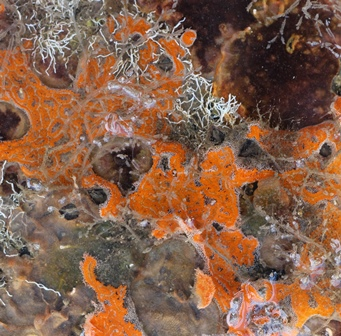
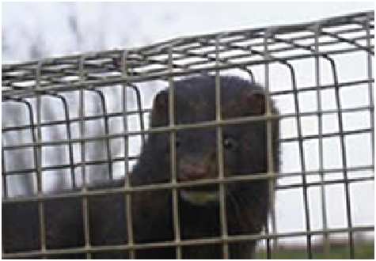

Analysis of variance (ANOVA) is one of the most frequently used techniques in the biological and environmental sciences. ANOVA is used to contrast a continuous dependent variable *y* across levels of one or more categorical independent variables *x*. The independent variables are termed the factor or treatment, and the various categories within that treatment are termed the levels. In this module, we will start with the simplest design - those with a single factor.

Where an independent samples *t*-test would be used for comparison of group means across two levels, ANOVA is used for the comparison of >2 group means, or when there are more than two or more predictor variables (see [ANOVA: factorial](#factorial-anova)). The logic of this test is essentially the same as the *t*-test - it compares variation between groups to variation within groups to determine whether the observed differences are due to chance or not.

## Single Factor ANOVA


For example, to contrast the the hatching times of turtle eggs incubated at four different temperatures (15°C, 20°C, 25°C and 30°C), hatching time is the continuous response variable and temperature is the categorical predictor variable with with four levels. The null hypothesis would be that mean hatching time is equal for all temperatures (H~o~: $\mu_{15} = \mu_{20} = \mu_{25} = \mu_{30}$).

Note that an ANOVA is a linear model, just like linear regression except that the predictor variables are categorical rather than continuous.

$$y_{ij} = \mu + \alpha_i + \varepsilon_{ij}$$

where $\mu$ is the overall mean and $\alpha_i$ is the effect of the i^th^ group.

It is the same as a multiple linear regression with a predictor variable for each level of the categorical variable (each coded as a dummy variable). For the question of whether hatching time of turtles differs between four incubation tempeatures, we must fit four parameters to describe the mean response of each temperature (rather than just a single intercept and single slope in a simple linear regression). For this example, our linear model equation will have this form:

$$HatchingTime = \mu + \beta_1.Temp_{15} + \beta_2.Temp_{20} + \beta_3.Temp_{25} + \beta_4.Temp_{30} + \varepsilon$$

ANOVA partitions the total variance into a component that can be explained by the predictor variable (among levels of the treatment), and a component that cannot be explained (within levels, the residual variance). The test statistic, *F*, is the ratio of these two sources of variation.

$$F = \frac{MS_{among}}{MS_{within}}$$

where *MS* are the mean squares, a measure of variation. The probability of obtaining the observed value of *F* is calculated from the known probability distribution of *F*, with two degrees of freedom (one for the numerator = the number of levels -1) and one for the denominator (number of replicates per level - 1 x number of levels).

### Running the analysis

The data should be formatted such that the individual replicates are rows and the variables are separate columns. Include a column for the dependent variable, *y*, and a corresponding column for the categorical variable, *x*. Download the sample data set for the turtle hatching example, [Turtles.csv](../../datasets/Turtles.csv), import into R and check that temperature variable is a factor with the `str` function.

```{r}
#| label: anova-single-1
#| eval: false
Turtles <- read.csv(file = "data/Turtles.csv", header = TRUE)
str(Turtles)
```

In this case, because we have numbers for the four levels of the Temperature treatment, we need to change that variable to become a factor rather than an integer.

```{r}
#| label: anova-single-2
#| eval: false
Turtles$Temperature <- factor(Turtles$Temperature)
```

Now, we can run the analysis of variance contrasting hatching time (days) across temperatures using the function `aov`. The arguments of the function are simply a formula statement, `y~x`, with the response variable to the left of the ~, the predictor variable to the right, and some code to specify which data frame holds those variables.

```{r}
#| label: anova-single-3
#| eval: false
Turtles.aov <- aov(Days ~ Temperature, data = Turtles)
```

The output from this analysis can be seen by using the `summary` function on the object created.

```{r}
#| label: anova-single-4
#| eval: false
summary(Turtles.aov)
```

Exactly the same analysis can be reproduced using the linear model function `lm`.

```{r}
#| label: anova-single-5
#| eval: false
Turtles.lm <- lm(Days ~ Temperature, data = Turtles)
summary(Turtles.lm)
```

### Interpreting the results

```{r}
#| label: anova-single-6
#| echo: false
Turtles <- read.csv(file = "data/Turtles.csv", header = TRUE)
Turtles$Temperature <- factor(Turtles$Temperature)
Turtles.aov <- aov(Days ~ Temperature, data = Turtles)
summary(Turtles.aov)
```

The summary output of an ANOVA object is a table with the degrees of freedom (Df), sums of squares (Sum Sq), mean squares (Mean Sq) for the predictor variable (i.e., variation among levels of your treatment) and for the Residuals (i.e., varation within the levels). The test statistic, *F* value and its associated *p*-value (Pr(>F)) are also presented.

First check the degrees of freedom. The factor Df = the number of levels of your factor - 1. The residual Df = *a(n-1)*, where *a* = the number of levels of your factor and *n* = sample size (replicates per level).

The sums of squares and mean squares are measures of variation. The *F* statistic is the ratio of *MS~among~* and *MS~within~* and the *p*-value is the probability of the observed *F* value from the *F* distribution (with the given degrees of freedom).

The main thing to look at in the ANOVA table is whether your predictor variable had a significant effect on your response variable. In this example, the probability that all four incubation temperatures are equal is <0.001. This is very unlikely and much less than 0.05. We would conclude that there is a difference in hatching times between the temperatures. We are also interested in the R^2 value which tells us how much variation was explained by the model.

If you use the `lm` function, you get a bit more information from the summary of the linear model output.

```{r}
#| label: anova-single-7
#| echo: false
Turtles.lm <- lm(Days ~ Temperature, data = Turtles)
summary(Turtles.lm)
```

The output for the standard ANOVA table is down the bottom and above it you get the actual parameter estimates from the linear model (the $\beta_1$, $\beta_2$ etc from above). In this example, turtles at 15°C hatched after 58.4 days, on average (the intercept in the model). The other parameter estimates are differences between each level of temperature and the intercept. For example, at 20°C they were 13.8 days faster (i.e., the mean for 20°C = 58.4-13.8 = 44.6 days).

If you detect any significant differences in the ANOVA, we are then interested in knowing exactly which groups differ from one another, and which do not. Remember that a significant *p* value in the test you just ran would reject the null hypothesis the means of the dependent variable were the same across all groups, but not identify which were different from each other. To see a comparison between each mean and each other mean, we can use a Tukey's post-hoc test.

```{r}
#| label: anova-single-8
TukeyHSD(Turtles.aov)
```

### Assumptions to check

The important assumptions of ANOVA are independence, homegeneity of variance and normality. We advocate a qualitative evalutation of the normality and homogeneity of variance assumptions, by examining the patterns of variation in the residuals, rather than a formal test such has Cochran's test. Linear models in general are quite 'robust' for violating these assumptions (heterogeneity and normality), within reason.

**Normality.** The assumption of normality can be checked by a frequency histogram of the residuals or by using a quantile plot where the residuals are plotted against the values expected from a normal distribution. The histogram of residuals should follow a normal distribution. If the points in the quantile plot lie mostly on the line, the residuals are normally distributed. Both of these plots can be obtained from the model object created by the `aov` function.

```{r}
#| label: anova-single-9
par(mfrow = c(1, 2)) # This code put two plots in the same window
hist(Turtles.aov$residuals)
plot(Turtles.aov, which = 2)
```

Violations of normality can be fixed via transformations or by using a different error-distribution in a [generalised linear model (GLM)](generalised-linear-models.qmd).

**Homogeneity of variance.** The assumption of homgeneity of variance, namely that the variation in the residuals is approximately equal across the range of the predictor variable, can be checked by plotting the residuals against the fitted values from the `aov` model object.

```{r}
#| label: anova-single-10
plot(Turtles.aov, which = 1)
```

Heterogenous variances are indicated by non-random pattern in the residuals vs. fitted plot. Look for an even spread of the residuals on the *y* axis for each of the levels on the *x* axis. A fan-shaped distribution with more variance at higher values on the x axis is a common problem when data are skewed. If there are strong patterns, one potential solution is to transform the response variable *y*. If this doesn't fix the problem the best solution is to use a different error distribution in a [generalised linear model (GLM)](generalised-linear-models.qmd).

**Independence.** ANOVA assumes that all replicate measures are independent of each other (i.e., equally likely to be sampled from the population of possible values for each level). This issue needs to be considered at the design stage. If data are grouped in any way (e.g., half the turtle eggs measured at one time, then the other half measured later), then more complex designs are needed to account for additional factors (e.g., a design with both temperature and time as factors).

There are a variety of measures for dealing with non-independence. These include ensuring all important predictors are in the model; averaging across nested observations; or using a [mixed-model](mixed-effects-models.qmd#linear-mixed-models-with-one-random-effect).

### Communicating the results

**Written.**  The results of a one-way ANOVA are usually expressed in text as a short sentence, e.g., "Turtle hatching time differed among the four incubation temperatures (*F* = 15.98, *df* = 3,36, *p* < 0.001)". A significant effect would be followed by a written description of the post-hoc test results (i.e., exactly which temperatures differed from which). The results from post-hoc tests can also be added to the figure (e.g, by labelling which levels differed).

**Visual.**  A boxplot or column graph with error bars are suitable for contrasting a continuous variable across levels of categorical variable. See the graphics help for making publication ready versions of these figures.

```{r}
#| label: anova-single-11
boxplot(Days ~ Temperature, data = Turtles, ylab = "Hatching time (days)", xlab = "Temperature (°C)")
```

### Further help

Type `?aov` or `?lm` to get the R help for these functions.

<p style="margin-left:.5in;text-indent:-.5in">Quinn and Keough (2002) *Experimental design and data analysis for biologists.* Cambridge University Press. Ch. 8 Comparing groups or treatments - analysis of variance.</p>

<p style="margin-left:.5in;text-indent:-.5in">McKillup (2012) *Statistics explained. An introductory guide for life scientists* Cambridge University Press. Ch. 11. Single-factor analysis of variance.</p>

<p style="margin-left:.5in;text-indent:-.5in">Underood, AJ (1997) *Experiments in ecology: Their logical design and interpretation using analysis of variance.* Cambridge University Press.</p>

**Author**: James Lavender

**Year:** 2016

---

## Factorial ANOVA

Analysis of variance (ANOVA) is one of the most frequently used techniques in the biological and environmental sciences. ANOVA is used to contrast a continuous dependent variable *y* across levels of one or more categorical independent variables *x*. The independent variables are termed the factor or treatment, and the various categories within that treatment are termed the levels. Here, we will consider designs with two or more factors that are both applied to the experimental units (read the [Single Factor ANOVA](#single-factor-anova) section first if you are unfamiliar with ANOVA).

Frequently, we want to test for differences in a response variable due to two or more factors. These experimental or sampling designs allow us to test for the effects of each of these factors separately (termed *main effects*), and to test whether the two factors interact. For these designs, we use more complex versions of ANOVA than the most simple design that tests the effects of only one factor.



Consider an example where a researcher is testing the effects of metal contamination on the number of species found in sessile marine invertebrates (sponges, bryozoans and sea squirts etc.). They would like to know whether copper reduces species richness, but also know that the richness of invertebrates can depend on whether the substrate is vertical or horizontal. Consequently, they ran an experiment where species richness was recorded in replicate samples in each of the six combinations of copper enrichment ("None","Low","High") and orientation ("Vertical","Horizontal"). The experimental design in termed factorial because all levels of one treatment are represented in all levels of the other treatment (also termed orthogonal).

The factorial ANOVA will test:

* whether there are any differences in richness among the three levels of copper enrichment
* whether there are any differences in richness among the two levels of substrate orientation
* whether there is any interaction between copper and orientation

You have three null hypotheses:

* there is no difference between the means for each level of copper, H~o~: $\mu_{None} = \mu_{Low} = \mu_{High}$
* there is no difference between the means for each level of orientation, H~o~: $\mu_{Vertical} = \mu_{Horizontal}$
* there is no interaction between the factors

This is far better than running two separate single factor ANOVAs that contrast copper effects for each level of orientation because you have more statistical power (higher degrees of freedom) for the tests of interest, and you get a formal test of the interaction between factors which is often scientifically interesting.

Note that an ANOVA is a linear model, just like linear regression except that the predictor variables are categorical rather than continuous. With two predictor variables, the linear model is:

$$y_{ijk} = \mu + \alpha_i + \beta_j + (\alpha\beta)_{ij} + \varepsilon_{ijk}$$

where $\mu$ is the overall mean, $\alpha_i$ is the effect of the i^th^ group of the first factor, and $\beta_i$ is the effect of the j^th^ group of the second factor and $(\alpha\beta)$ is the interaction.

Athough we have two factors, and an interaction effect, this requires fitting more than 3 parameters in our model because we have 3 levels of Factor A (Copper) and 2 levels of Factor B (Orientation) (if you can figure out how many parameters must be fit in this model, you are officially a stats geek! This is tricky even for those 'in the know').

With two factors, ANOVA partitions the total variance into a component that can be explained by the first predictor variable (among levels of the treatment A), a component that can be explained by the second predictor variable (among levels of the treatment B), a component that can be explained by the interaction, and a component that cannot be explained (within levels, the residual variance). The test statistic, *F*, is calculated three times to test each of the null hypotheses. For two fixed factors, the *F* ratios are:

$$F = \frac{MS_{A}}{MS_{within}}$$
$$F = \frac{MS_{B}}{MS_{within}}$$
$$F = \frac{MS_{AB}}{MS_{within}}$$

where *MS* are the mean squares, a measure of variation. The probability of obtaining the observed value of *F* is calculated from the known probability distribution of *F*, with two degrees of freedom (one for the numerator = the number of levels -1) and one for the denominator. Note that these *F* ratios will change if any factors are random (see below for the distinction between fixed and random factors).

### Running the analysis

Your data should be formatted with the measurements from each replicate as a row and each of the variables as columns, corresponding to the dependent variable *y*, Factor A and Factor B.

Download the sample data set for the sessile invertebrates, [Sessile.csv](../../datasets/Sessile.csv), and import into R to to see the desired format. Check that your predictor variables are factors with the function `str`

```{r}
#| label: anova-factorial-1
#| eval: false
Sessile <- read.csv(file = "data/Sessile.csv", header = TRUE)
str(Sessile)
```

With our predictor variable correctly assigned as factors, we can now run the analysis. As with other forms of linear models we have a model formula with the dependent variable, *y*, to the left of the ~ and the predictor variables to the right. For this two factor design, we use:

```{r}
#| label: anova-factorial-2
#| eval: false
Sessile.aov <- aov(Richness ~ Copper * Orientation, data = Sessile)
```

Note that when you specify a model with * between the two predictors, R automatically includes both variables and their interaction. This same model could also be written as:

```{r}
#| label: anova-factorial-3
#| eval: false
Sessile.aov <- aov(Richness ~ Copper + Orientation + Copper:Orientation, data = Sessile)
```

The output from this analysis can be seen by using the `summary` function on the object created.

```{r}
#| label: anova-factorial-4
#| eval: false
summary(Sessile.aov)
```

Exactly the same model can also be run using the linear model function, `lm`.

```{r}
#| label: anova-factorial-5
#| eval: false
Sessile.lm <- lm(Richness ~ Copper * Orientation, data = Sessile)
anova(Sessile.lm)
```

### Interpreting the results

```{r}
#| label: anova-factorial-6
#| echo: false
Sessile <- read.csv(file = "data/Sessile.csv", header = TRUE)
Sessile.aov <- aov(Richness ~ Copper * Orientation, data = Sessile)
summary(Sessile.aov)
```

The summary output of an ANOVA object is a table with the degrees of freedom (Df), sums of squares (Sum Sq), mean squares (Mean Sq) for the each of predictor variable (i.e., variation among levels of your treatments), their interaction and for the Residuals (i.e., varation within the levels). The test statistic, *F* value and its associated *p*-value (Pr(>F)) are also presented.

Check that you have the correct degrees of freedom. For a two factor design with fixed factors they are:

* Factor A: *a* - 1 (where *a* = number of levels of Factor A)
* Factor B: *b* - 1 (where *b* = number of levels of Factor B)
* Interaction (AB): (*a*-1)(*b*-1)
* Residual: *ab*(*n* -1) (where *n* = sample size)

The sums of squares and mean squares are measures of variation. There are three *F* statistics, corresponding to a test of each of the main effects and one for the interaction. The *p*-values are the probabilities of the observed *F* values from the *F* distribution (with the given degrees of freedom).

In this example, there is strong evidence to reject all three null hypotheses:

* that all levels of the copper treatment are equal (P < 0.001),
* that the vertical and horizontal orientations are equal (P < 0.001)
* that there is no interaction between copper and orientation (P < 0.001)

A significant interaction means that the effect of one factor depends upon the other. In this example, it would mean that the effect of copper was not consistent between the vertical and horizontal habitats. Consequently, the interpretation of the main effects becomes more complex. See [Understanding interactions](understanding-interactions.qmd) for more help on interpreting interactions in linear models. A quick way to help you understand an interaction if you get one is to examine an interactions plot.

```{r}
#| label: anova-factorial-7
interaction.plot(Sessile$Copper, Sessile$Orientation, Sessile$Richness)
```

Here you can see that the effect of copper (a decline in species richness) is more pronounced in the habitats with a vertical orientation, and that the difference between the two habitats changes with exposure to copper.

**Multiple comparisons.** If you detect any significant differences in the ANOVA, we are then interested in knowing exactly which levels differ from one another, and which do not. Remember that a significant *p* value in the test you just ran would reject the null hypothesis the means were the same across all groups, but not identify which were different from each other. If there is no interaction, you can run a *post-hoc* test on each of the main effects (only needed if there are more than two levels for an effect). If there is an interaction, you will need to consider *post-hoc* tests that contrast the means from all combinations of both factors.

### Assumptions to check

The assumptions of factorial ANOVA's are the same as for all linear models including the simpler [single-factor ANOVAs](#single-factor-anova), being independence, normality and homogeneity of variances. We also need to consider two new issues: 1) whether your factors are fixed or random, and 2) whether your sampling or experimental design is balanced (i.e., has the same number of replicates in each combination of treatments).

**Fixed and random factors.** There is an important distinction between factors whose levels are the only ones of interest (termed fixed), and factors whose levels are a sampled from a larger collection of possible levels (termed random). For example, if we repeated the experiment above at three different sites in Sydney Harbour, chosen from many possible sites, we would consider site a random factor. We are not interested in those sites in particular, but would like to know if our experimental treatments were consistent across sites. On the other hand, if you were only interested in Darling Harbour and Circular Quay, then these two could be considered two levels of a fixed factor. Treating sites as a fixed factor in that case means that you conclusions should not be extrapolated to other possible sites, but restricted to those particular sites.

Statistically, there is a big difference between a fixed factors were you have measured all possible levels of interest (e.g, control vs a single treatment) and random factors where the levels are sampled from all possible levels. In analysis of variance, all this matters because the *F* tests that are being used to test your hypotheses are constructed differently depending on which factors are fixed and random. In the example above, all factors were fixed and the denominator of all *F* tests was $MS_{within}$. In models with all factors random, and models with a mix of fixed and random factors (termed mixed effects models), other components of the variation are used as the denominators in the *F* tests.

If you have random factors, you will need to read more than this help page to establish the correct *F* ratios for your design, and you may need to calculate them manually. Note that the code presented will give correct *F* tests only for designs with all factors fixed. You should also strongly consider analysing your data as a [mixed model](mixed-effects-models.qmd).

**Balanced and unbalanced designs.** Ideally, factorial ANOVA should be conducted with a balanced design - one with  the same number of replicates in each combination of factors. Balanced designs are less likely to be affected by minor deviations from the assumptions of normality and homogeneity of variance. Unfortunately, unbalanced designs where you have unequal numbers of replicates for each level are common in practice (e.g. bad weather prevented sampling the second site as intensively, volunteer lost the data sheet etc!).

Unbalanced designs are more susceptible to violating the assumptions of ANOVA and there is no single way to partitioning the $SS_{total}$ into the main effect and interaction components. The `aov` and `lm` functions in R use what are called Type I sums of squares where the terms in the model are fitted sequentially. This means that the order of the terms in model matters. There is a fair bit of debate on this in the statistical literature, but many advise using Type II or Type III sums of squares for unbalanced designs. To access these in R, we can use the `Anova` function in the [car](https://cran.r-project.org/web/packages/car/index.html) package.

There is a fair bit of debate on this in the statistical literature, but many advise using what are called Type II or Type III sums of squares for unbalanced designs. Other software packages like SPSS, SYSTAT and Minitab will automatically use Type III sums of squares where the order of terms in the model doesn't matter. To access these in R, we can use the `Anova` function in the [car](https://cran.r-project.org/web/packages/car/index.html) package.

**Normality.** The assumption of normality can be checked by a frequency histogram of the residuals or by using a quantile plot where the residuals are plotted against the values expected from a normal distribution. The histogram of residuals should follow a normal distribution. If the points in the quantile plot lie mostly on the line, the residuals are normally distributed. Both of these plots can be obtained from the model object created by the `aov` function.

```{r}
#| label: anova-factorial-8
par(mfrow = c(1, 2)) # This code put two plots in the same window
hist(Sessile.aov$residuals)
plot(Sessile.aov, which = 2)
```

Violations of normality can be fixed via transformations or by using a different error-distribution in a [generalised linear model (GLM)](generalised-linear-models.qmd).

**Homogeneity of variance.** The assumption of homgeneity of variance, namely that the variation in the residuals is approximately equal across the range of the predictor variable, can be checked by plotting the residuals against the fitted values from the `aov` model object.

```{r}
#| label: anova-factorial-9
plot(Sessile.aov, which = 1)
```

Heterogeneous variances are indicated by non-random pattern in the residuals vs. fitted plot. Look for an even spread of the residuals on the y axis for each of the levels on the x axis. A fan-shaped distribution with more variance at higher values on the x axis is a common problem when data are skewed. See the testing assumptions of linear models module for more information. If there are strong patterns, one potential solution is to transform the response variable *y*. If this doesn't fix the problem the best solution is to use a different error distribution in a  [generalised linear model (GLM)](generalised-linear-models.qmd).

**Independence.** ANOVA assumes that all replicate measures are independent of each other (i.e., equally likely to be sampled from the population of possible values for each level). This issue needs to be considered at the design stage. If data are grouped in any way (e.g., half the invertebrate samples measured at one time, then the other half measured later), then more complex designs are needed to account for additional factors (e.g., a design with an additional factor of sampling time).

There are a variety of measures for dealing with non-independence. These include ensuring all important predictors are in the model; averaging across nested observations; or using a [mixed model](mixed-effects-models.qmd)

### Communicating the results

**Written.**  The results of the main effects and any interaction should be described in the text of a results section. Each *F* test can be described in the text, e.g., "The copper treatment and substrate orientation interacted to affect the species of sessile invertebrates (*F* = 19.33, df = 2,54, *p* < 0.001)". Alternatively, all tests could be put into a Table like the one given in the output following `summary(Sessile.aov)` above. Description of the main tests would be followed by a description of the *post-hoc* results if used.

Remember that the interpretation of the main effects is complicated when there is a significant interaction (see above). In this example, while copper reduced species richness, that effect was not consistent between the two habitats. In other scenarios with an interaction, you might have copper affecting richness in one habitat but not another, preventing you making a simple statement like "copper reduced species richness" because it wouldn't always be true. 

**Visual.** A boxplot or column graph with error bars are suitable for contrasting a continuous variable across levels of categorical variable. See the graphing modules for making publication ready versions of these figures.

```{r}
#| label: anova-factorial-10
boxplot(Richness ~ Copper * Orientation, data = Sessile, names = c("High.H", "Low.H", "None.H", "High.V", "Low.V", "None.V"), ylab = "Species richness", xlab = "Copper/Orientation", ylim = c(0, 80))
```

### Further help

Type `?aov` or `?lm` to get the R help for these functions.

<p style="margin-left: .5in; text-indent: -.5in;">Quinn and Keough (2002) *Experimental design and data analysis for biologist.* Cambridge University Press. Ch. 9 Multifactor analysis of variance.</p>

<p style="margin-left: .5in; text-indent: -.5in;">McKillup (2012) *Statistics explained. An introductory guide for life scientists* Cambridge University Press. Ch. 13 two-factor analysis of variance.</p>

<p style="margin-left: .5in; text-indent: -.5in;">Underwood (1997) *Experiments in ecology: Their logical design and interpretation using analysis of variance.* Cambridge University Press.</p>

**Authors:** James Lavender & Alistair Poore

**Year:** 2016

---

## Nested ANOVA

### Usage

In the two-way ANOVA design, the two factors are known as factorial (i.e., there was every combination of every level of each factor). Other experimental designs feature factors that are termed nested. This is when each level of one of the factors is unique to only one level of the other factor. The difference is best illustrated with the following two experimental designs where there are two factors, A and B.

In the nested design, the levels of factor B appear in only one of the levels in factor A, not both. This often happens with factors like "site" or "area" - they usually belong to only one level of your other factor (e.g., if contrasting north and south of the harbour, a suburb could not be in both categories).

Factor B is termed nested within factor A, usually written as B(A). These designs have different sources of variance to the factorial designs, and do not have an interaction term. The designs are quite common in ecology and environmental sciences, and are often used to partition variance in spatially hierarchical sampling (e.g., habitats, areas within habitats, plots within areas etc.).

The examples below comes from an experiment investigating the impact of introduced American mink on small rodents (voles) in Finland. The hypothesis was that mink prey upon voles thereby reducing vole numbers and limiting their population size. To test this, minks were removed from large areas (> 20 km2) in the Baltic Sea. The Ho from the experiment is that the mean count of voles on islands in removal sites will be the same as the mean vole count on islands in control areas.



The data represent two treatments (mink removal and control) and two areas nested within each treatment. Then there are 10 samples in each area. Each of these samples represents the numbers of individual voles trapped on an island (all islands were more than 300 m apart ensuring some independence) over 4 nights.

The design is nested because an area cannot belong to both a removal treatment and a control. It is useful to think of areas as being the replicates for the treatment, and the individual samples as being replicates for each area.

### Running the analysis

Data for a nested design should be in the format of samples as rows and variables as columns. A column should correspond to the dependent variable *y*, in this case, number of voles. Another column should contain the levels of the fixed factor A, Treatment. Finally, a column for the levels of the nested random factor B, Area.

```{r}
#| label: anova-nested-1
# Input data file
Mink <- read.csv(file = "data/Mink.csv", header = TRUE)
# Check the structure of the data
str(Mink)
# Run the analysis
Mink.nested <- aov(Voles ~ Treatment + Area %in% Treatment, data = Mink)
summary(Mink.nested)
```

### Interpreting the results

The output is a little different to the factorial ANOVA. The top section gives a significance test of the fixed effect, *Treatment* - this is what we're interested in. The residuals for this test are those associated with the random effect 'Area'.

A significant F-ratio (P<0.05) for a nested factor indicates high variance among subgroups within a group. For example, a difference in mean vole numbers of the two areas within a treatment. This is expected, however, leads to few degrees of freedom to test main effects. Additionally, it suggests treatments may not have a uniform effect across levels of the nested factor. For example, voles in one removal area showed a stronger response than another area.

**F-ratios**

* Among groups = MSamong/MSsubgroup
* Factor B = MSsubgroup/MSResidual

**Degrees of freedom**

* Among groups  = (a - 1) (where a = number of levels of Factor A)
* Among subgroups = a(b - 1) (where b = number of levels of Factor B)
* Within subgroups = ab(n - 1) (where n = sample size)

Where there are greater than 2 levels of the the fixed factor of interest, post-hoc analysis can be used to determine which groups differ. Refer to the *post-hoc* module for further information.

**Pooling**

Always examine nested factors before the upper levels. If the variance explained by the nested factor is negligible, it can be pooled. If the F ratio of MSsubgroup/MSwithin is non significant then you don't need subgroups and can perform a one factor analysis.

Even if MSsubgroup/MSwithin is non-significant at a = 0.05, there may be subgroup effects (may be high Type II error). To be cautious, only pool SS when P>0.25, so there is very little chance that you are incorrectly accepting the null hypothesis of no effect.

### Assumptions to check

The same assumptions of linear models apply to nested ANOVAs; independence, normality and heterogeneity of variances. Independence needs to be considered at the design stage (see *independence* module). We can now check the assumptions of homgeneity of variance (namely that the residuals are homgeneous i.e., approximately equal), and normality (even disturbiton of data about the mean, no wonky outliers).

Because tests of the fixed factor A uses the means of the nested Factor B, the assumptions of homogeneity and normality apply with respect to the means of Factor B. Normality of Factor A are likely to be normally distributed based upon the Central Limit Theorem.

We advocate a qualitative evalutation of the assumptions, rather than a formal test suc has Cochran's test. Linear models in general are quite 'robust' for violating these assumptions (heterogeneity and normality), within reason.

The assumption of normality can be checked by a frequency histogram of the residuals or using a quantile plot where the residuals are plotted against the values expected from a normal distribution. The historgram of residuals should follow a normal distribution. If the points in the quantile plot lie mostly on the line, the residuals are normally distributed. Violations of normality can be fixed via transformations or by using a different error-distribution in a GLM. See the GLM module for more information. The plot() function on a model object provides a series of four graphical model diagnostics, the second of which is a quantile plot.

```{r}
#| label: anova-nested-2
hist(Mink.nested$residuals)
plot(Mink.nested, which = 2)
```

Heterogenous variances is indicated by non-random pattern in the residuals vs. fitted plot. If there is strong patterns, one potential solution is to transform the response variable *y*. If this doesn't fix the problem the best solution is to use a different error distribution in a generalised linear model framework (GLM).

```{r}
#| label: anova-nested-3
plot(Mink.nested$residuals ~ Mink.nested$fitted)
```

```{r}
#| label: anova-nested-4
#| eval: false
# Alternative option
plot(Turtles.ANOVA, which = 1)
```

### Communicating the results

**Written.** The subgroup factor is rarely of interest and so is given little emphasis in the results. For example, "the abundance of voles was significantly greater where minks have been removed (F = 38.39, P <0.001)".

**Visual.** A boxplot would be a suitable means of displaying the differences between the groups of the factor of interest, in this case *Treatment*.

```{r}
#| label: anova-nested-5
#| echo: false
# plot(Voles~Treatment,data=Mink)
```

### Further help

Type `?aov` to get the R help for this function.

<p style="margin-left:.5in;text-indent:-.5in">Quinn and Keough (2002) *Experimental design and data analysis for biologist.* Cambridge University Press.</p>

<p style="margin-left:.5in;text-indent:-.5in">McKillup (2012) *Statistics explained. An introductory guide for life scientists* Cambridge University Press.</p>
