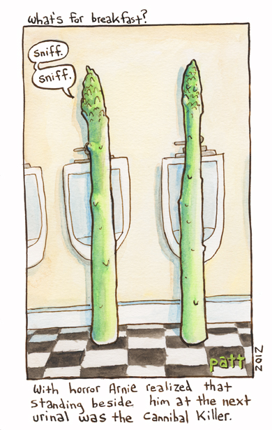

Fisher's exact test is used to test for an association between two categorical variables when sample sizes are small. Like a [contingency table](contingency-tables.qmd) analysis, it asks whether counts of observations classified by two variables differ from what we would expect if the variables were independent. The difference is in how the *p*-value is obtained. The $\chi^2$ test compares a test statistic to the $\chi^2$ distribution, an approximation that only works well when the expected counts are reasonably large. Fisher's exact test calculates the probability of the observed counts directly, so it gives a valid *p*-value however small the counts are.

{fig-alt="A ringtail possum climbing along a eucalyptus branch at night"}

For example, consider a behavioural ecologist studying the diet of common ringtail possums (*Pseudocheirus peregrinus*) at two sites, each dominated by one of two species of eucalypt (*Eucalyptus ovata* and *E. sideroxylon*). Possums at site A seem to eat mostly *E. ovata*, and possums at site B mostly *E. sideroxylon*. To test whether the two populations differ in their feeding preferences, radio collars were attached to seven possums at site A and eight at site B, and each possum was tracked to record the species of the first tree it was seen feeding from.

At site A, six possums fed on *E. ovata* and one on *E. sideroxylon*. At site B, none fed on *E. ovata* and all eight fed on *E. sideroxylon*:

```{r}
#| label: fishers-exact-1
#| echo: false
possum <- matrix(c(6, 0, 1, 8), nrow = 2, dimnames = list(c("Site A", "Site B"), c("E. ovata", "E. sideroxylon")))
possum
```

If feeding preference did not differ between sites, the counts expected in each cell would be *(row total x column total)/grand total*, as for a contingency table:

```{r}
#| label: fishers-exact-2
#| echo: false
#| warning: false
chisq.test(possum)$expected
```

All four expected counts are below 5, so a $\chi^2$ test would not be reliable here (R warns that the "Chi-squared approximation may be incorrect"). This is the situation Fisher's exact test is designed for.

The test takes the row and column totals as fixed: 7 possums at site A, 8 at site B, 6 feeding on *E. ovata* and 9 on *E. sideroxylon*. It then asks: if site had nothing to do with tree choice, and the 6 *E. ovata* feeders were drawn at random from the 15 possums, how likely is a split as uneven as the one observed? The probability of each possible table with those totals comes from the hypergeometric distribution, and the *p*-value is the sum of the probabilities of the observed table and of every table at least as unlikely as it.

## Running the analysis

Enter the observed counts as a matrix. `nrow` tells R how many rows there are, and `dimnames` labels the rows and columns:

```{r}
#| label: fishers-exact-3
#| eval: false
possum <- matrix(c(6, 0, 1, 8), nrow = 2, dimnames = list(c("Site A", "Site B"), c("E. ovata", "E. sideroxylon")))
```

R fills a matrix column by column, so the first two numbers are the *E. ovata* counts for sites A and B. Check that the data have been entered correctly by printing the matrix:

```{r}
#| label: fishers-exact-4
#| eval: false
possum
```

Then run the test with the `fisher.test` function:

```{r}
#| label: fishers-exact-5
#| eval: false
fisher.test(possum)
```

## Interpreting the results

```{r}
#| label: fishers-exact-6
#| echo: false
fisher.test(possum)
```

The *p*-value is the probability of obtaining counts this extreme or more extreme if the null hypothesis (no association between site and tree species) were true. Here it is 0.0014, so we would reject the null hypothesis and conclude that possums at the two sites differ in which tree species they feed on.

In this example, the observed table happens to be the only one counted: every other table with the same totals is more likely, so the *p*-value is simply the probability of the observed table. You can check this with the hypergeometric distribution: the chance of drawing all 6 *E. ovata* feeders from the 7 site A possums, out of 7 site A and 8 site B possums:

```{r}
#| label: fishers-exact-7
dhyper(6, 7, 8, 6)
```

For a 2 x 2 table, `fisher.test` also gives an **odds ratio** and its 95% confidence interval. The odds ratio describes the strength of the association: the odds of feeding on *E. ovata* rather than *E. sideroxylon* at site A, divided by the same odds at site B. An odds ratio of 1 means no association. Here the estimate is `Inf` because no site B possum fed on *E. ovata*, which makes the odds at site B zero. That is common with small samples and isn't an error. The confidence interval (2.9 to infinity) is the more useful summary: the odds of feeding on *E. ovata* are at least about three times higher at site A.

By default the test is two-sided. If you had predicted the direction of the difference before collecting the data, you could use `alternative = "greater"` or `alternative = "less"`.

## Assumptions to check

**Independence.** As for the $\chi^2$ test, each observation must be classified independently of the others. Here that means each possum is counted once, and possums are not, for example, following each other to the same trees. Recording only the first tree each possum fed from, rather than every feeding event, is what keeps the observations independent.

**Fixed totals.** The test treats the row and column totals as fixed. In most field studies only one set of totals is fixed by the design (here the number of possums collared at each site), and the test is then slightly conservative: the *p*-values tend to be a little larger than they should be. This rarely matters in practice, and the test is still widely used for these designs.

Unlike the $\chi^2$ test, there is no minimum expected count. With large samples, the $\chi^2$ test and Fisher's exact test give very similar *p*-values, so the $\chi^2$ test is usually used when its sample size assumption is met.

## Larger tables

Fisher's exact test is not limited to 2 x 2 tables. `fisher.test` works on any two-way table, although it can be slow when both the table and the counts are large.

{fig-alt="Cartoon titled 'What's for breakfast?' of two asparagus spears standing at urinals, one sniffing, with the caption 'With horror Arnie realized that standing beside him at the next urinal was the Cannibal Killer'"}

For example, some people notice a distinctive smell in their urine after eating asparagus, while others never do. This could be because people differ in how they metabolise compounds from asparagus, or because they differ in their ability to detect the smell. Pelchat *et al.* (2011) reviewed studies of the smell and reported these counts from four study populations:

```{r}
#| label: fishers-exact-8
#| echo: false
asparagus <- matrix(c(328, 96, 10, 11, 0, 2, 5, 10), nrow = 4, dimnames = list(c("Israel (Lison et al. 1980)", "China (Hoffenberg 1983)", "USA (Sugarman and Neelon 1985)", "USA (Lison et al. 1980)"), c("Can detect odour", "Cannot detect odour")))
asparagus
```

If all populations had the same proportion of people able to detect the odour, the expected counts would be:

```{r}
#| label: fishers-exact-9
#| echo: false
#| warning: false
chisq.test(asparagus)$expected
```

All four expected counts in the "Cannot detect odour" column are below 5, and two are below 1, so again a $\chi^2$ test would not be reliable. Fisher's exact test can be used instead:

```{r}
#| label: fishers-exact-10
fisher.test(asparagus)
```

The populations clearly differ in their ability to detect the smell (*P* < 0.001). No odds ratio is given, because a single odds ratio only describes a 2 x 2 table. To see where the differences lie, look at the proportions in each population: almost everyone in the Israeli and Chinese samples could detect the odour, but a third to half of the people in the two US samples could not.

```{r}
#| label: fishers-exact-11
prop.table(asparagus, margin = 1)
```

## Communicating the results

**Written.** The results of Fisher's exact test can be presented in the text of a results section. For example, "Possums at the two sites differed in the tree species they fed on (Fisher's exact test, *P* = 0.001): six of seven possums at site A fed on *E. ovata*, while all eight possums at site B fed on *E. sideroxylon*." With such small samples, give the counts themselves, as they are easier to understand than percentages.

**Visual.** As for contingency tables, the counts can be shown as a bar plot with the categories on the X axis:

```{r}
#| label: fishers-exact-12
#| fig-alt: "Grouped bar chart of the number of possums feeding on each tree species at two sites: at site A six fed on E. ovata and one on E. sideroxylon, while at site B none fed on E. ovata and eight fed on E. sideroxylon"
barplot(t(possum), beside = TRUE, ylab = "Number of possums", xlab = "Site", col = c("darkgreen", "lightgreen"))
legend("top", c("E. ovata", "E. sideroxylon"), pch = 15, col = c("darkgreen", "lightgreen"))
```

See the graphing modules for making better versions of these figures that are suitable for reports or publications.

## Further help

Type `?fisher.test` to get the R help for this function.

Pelchat ML, Bykowski C, Duke FF and Reed DR (2011) Excretion and perception of a characteristic odor in urine after asparagus ingestion: a psychophysical and genetic study. *Chemical Senses* 36: 9-17.

Quinn and Keough (2002) *Experimental design and data analysis for biologists*. Cambridge University Press. Chapter 14. Analyzing frequencies.

McKillup (2012) *Statistics explained. An introductory guide for life scientists.* Cambridge University Press. Chapter 20.3 Comparing proportions among two or more independent samples.

**Author**: Alistair Poore

**Year:** 2016 (updated 2026)
